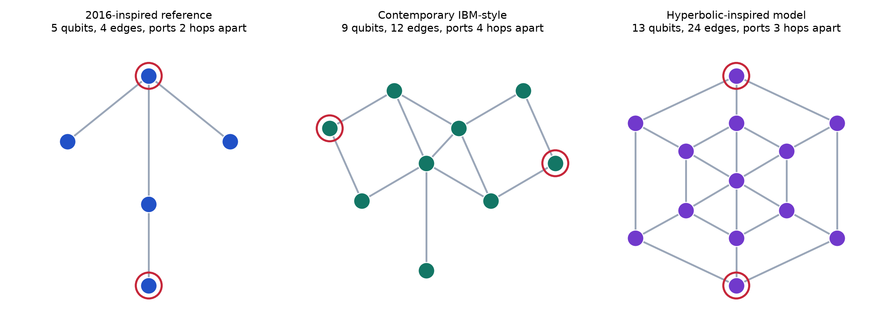

<!-- docs/CHALLENGE.md -->
# The challenge

**What the quanTA challenge at the UCF IBM Qiskit Fall Fest 2026 asks, stated once** for teammates, judges and anyone who runs the benchmark. It assumes Python and basic linear algebra but no quantum computing: each quantum term is defined where it first appears, and [Terms](#terms) collects the ones other docs use. Other docs link here instead of restating the requirements. The requirements come from the organisers' slide deck (quanTA's 14 slides, which the sections below cite by slide number), their example notebook and their statements at the event ([Sources and which governs](#sources-and-which-governs)).

On each of three processor models, the challenge asks us to:

1. **Create a verified Bell pair** in the state |Φ+⟩ between two fixed qubits, the ports.
2. **Establish an ideal baseline and a noisy baseline.**
3. **Test one justified error-detection or protection strategy.**
4. **Compare the fidelity with the circuit cost and any discarded shots,** and explain the differences between the three processor models.

In this file:

| Section | What it covers |
|---|---|
| [The target state](#the-target-state) | The Bell pair in linear-algebra terms, and what the baselines are. |
| [Why routing matters](#why-routing-matters) | The problem the challenge measures. |
| [The three processor models](#the-three-processor-models) | The graphs and their ports. |
| [Noise is the team's choice](#noise-is-the-teams-choice) | What is free and what still binds. |
| [Verifying the pair](#verifying-the-pair) | The measurements and the fidelity formula. |
| [The nine core cases](#the-nine-core-cases) | The comparison grid. |
| [Protection strategies](#protection-strategies) | The options and their reporting rule. |
| [What is fixed and what we choose](#what-is-fixed-and-what-we-choose) | The rules. |
| [What every result reports](#what-every-result-reports) | The five measures. |
| [The organisers' worked example](#the-organisers-worked-example) | A reference to check against. |
| [Interpreting the comparison](#interpreting-the-comparison) | What the results must explain. |
| [What to submit](#what-to-submit) | The five materials and the video. |
| [Judging](#judging) | The rubric. |
| [Terms](#terms) | The definitions. |
| [Sources and which governs](#sources-and-which-governs) | Where each requirement comes from. |
| [Where to go next](#where-to-go-next) | The other docs. |

## The target state

**The target is the Bell state |Φ+⟩ = (1, 0, 0, 1)/√2, held by the two ports.**

- **A qubit's state** is a unit vector in ℂ², with basis vectors |0⟩ = (1, 0) and |1⟩ = (0, 1).
- **Two qubits** share one unit vector in ℂ² ⊗ ℂ² = ℂ⁴, with basis |00⟩, |01⟩, |10⟩ and |11⟩.
- **The target** is the vector |Φ+⟩ = (|00⟩ + |11⟩)/√2 = (1, 0, 0, 1)/√2.

What follows from it:

- It is **not the tensor product of two one-qubit vectors,** so neither qubit has a state vector of its own. A state like this is **entangled**.
- **Measuring** a state gives each basis outcome with probability equal to the squared magnitude of its entry. For |Φ+⟩, measuring both qubits gives 00 or 11, each with probability |1/√2|² = 1/2, and never 01 or 10.
- A **Bell pair** is two qubits in this state.
- **Verified** means measured in three bases, because agreement in one basis alone would also fit a classical mixture of 00 and 11 ([Verifying the pair](#verifying-the-pair)).

**How a pair is made.** A **circuit** is a sequence of gates, each a unitary matrix acting on one or two qubits, followed by measurements, and every qubit starts in |0⟩. One way to make the pair: H = [[1, 1], [1, −1]]/√2 on the first qubit turns |00⟩ into (|00⟩ + |10⟩)/√2, then CX, which flips the second qubit when the first is 1, turns that into |Φ+⟩. The challenge fixes the target, not the circuit; the organisers' version is in [their worked example](#the-organisers-worked-example).

A **baseline** is the pair made and moved to the ports with no protection. Each baseline is judged by its fidelity F, how close the pair is to |Φ+⟩ ([Verifying the pair](#verifying-the-pair)). F = 1 means the pair is exactly |Φ+⟩, and F = 0 means none of |Φ+⟩ is left.

- The **ideal baseline** simulates the circuit with perfect operations. F must be 1, so a lower value points to a mistake in the circuit, not to noise.
- The **noisy baseline** simulates the same circuit with random errors on its operations, following a noise model ([Noise is the team's choice](#noise-is-the-teams-choice)). It is what protection is measured against.

## Why routing matters

**A qubit can interact directly only with its neighbours on the processor, so two distant ports need routing, and under noise the operations routing adds can lower the quality of the result.** The challenge measures that cost on three processor models. Routing usually adds **SWAP operations**, each of which exchanges the states of two neighbouring qubits, until the two qubits that must interact sit side by side.

quanTA, the University of Saskatchewan group that set the challenge, studies how a processor's geometry shapes error detection. Its three models are IBM's five-qubit cloud processor of 2016, a contemporary IBM-style layout, and a hypothetical graph inspired by hyperbolic geometry.

## The three processor models

**The three processor models are the organisers' three coupling graphs, exactly as the example notebook gives them, with the ports at the positions circled in red on slide 4 of the organisers' deck.** The organisers stated at the event that these graphs are exact.

- A **coupling graph** has a node for each qubit and an edge for each pair of qubits that a two-qubit gate can act on directly.
- A **two-qubit gate** is an operation on two qubits at once, a 4×4 unitary matrix acting on their joint state in ℂ⁴.
- A **port** is one of the two qubits where the Bell pair must end up.

| Model | Graph | Ports: position (notebook label) | Hops between ports |
|---|---|---|---|
| 2016-inspired reference | 5 qubits, 4 edges, a T shape | Top and bottom (0 and 4) | 2 |
| Contemporary IBM-style | 9 qubits, 12 edges | Left and right ends (0 and 7) | 4 |
| Hyperbolic-inspired model | 13 qubits, 24 edges | Top and bottom (0 and 12) | 3 |



The figure is drawn by `make figures` from the same processor files the code runs on.

A **hop** is one edge, so the hop count is the fewest edges on any path between the two ports. **The edge lists live once,** in the processor files under [`config/processor/`](../config/processor/), and this file never copies them.

**The port positions are the requirement, and the numbers are only labels.** Slide 4's drawings carry no qubit numbers, so the example notebook assigns its labels by position, and another labelling of the same graph could differ.

**The organisers' statement at the event settles two things slide 4 left open:**

- **The edges.** Slide 4 draws the three graphs but lists no edges, so the example notebook's edge lists are the exact graphs.
- **The contemporary model's graph.** Slide 4 describes this model as a backend snapshot, also called a fake backend, which is Qiskit's stored copy of a real IBM processor with its own graph, **native gates** (the gates the processor runs directly) and calibrated noise values. The model's graph is still the organisers' 9-node graph, **never the snapshot's**. A snapshot can supply the noise values and native gates, and ours does ([DESIGN.md, section 4](DESIGN.md#4-noise-model)).

The noise model itself is the team's choice ([Noise is the team's choice](#noise-is-the-teams-choice)).

Slide 4 marks the hyperbolic-inspired model as hypothetical connectivity and a circuit-level model only: no real processor has its graph, so a result on it describes circuits under the assumed noise, not a device.

## Noise is the team's choice

**Each team chooses its own noise model, as the organisers stated at the event.** The deck still binds how the noise is reported.

- A **noise model** says which random errors act on which operations, and how often.
- Under noise, the pair is no longer one state vector but a **mixture**: with probability pᵢ it is the vector ψᵢ.
- A mixture is written as a **density matrix** ρ = Σ pᵢ ψᵢ ψᵢ†, a 4×4 matrix for two qubits.

The statement at the event replaces two lines of the deck. Slide 9 lists noise assumptions among the requirements common to every team, and slide 4 gives the 2016-inspired model a synthetic noise model. **Neither binds.**

**What still binds:** the submission notebook states the noise assumptions (slide 13), and the comparison meets the two duties slide 12 sets, in [Interpreting the comparison](#interpreting-the-comparison).

Our noise model and its reasons are in [DESIGN.md, section 4](DESIGN.md#4-noise-model). The README's [science rules](../README.md#science-rules) say how we keep connectivity apart from noise.

## Verifying the pair

**The pair is verified by measuring the two ports in three bases, ZZ, XX and YY, turning each basis's counts into a correlator, and combining the three correlators into the fidelity F.** The bases come from the Pauli matrices, each with eigenvalues +1 and −1:

X = [[0, 1], [1, 0]],  Y = [[0, −i], [i, 0]],  Z = [[1, 0], [0, −1]].

A measurement reads a qubit in the basis |0⟩, |1⟩, the eigenvectors of Z, and returns bit 0 for eigenvalue +1 and bit 1 for −1. To read in the eigenbasis of X or Y instead, gates first rotate that basis onto |0⟩, |1⟩, with H = [[1, 1], [1, −1]]/√2 and S† = [[1, 0], [0, −i]]:

- **ZZ:** measure both qubits directly.
- **XX:** apply H to both qubits, then measure.
- **YY:** apply S† then H to both qubits, then measure.

Two terms turn the measurements into numbers:

- A **shot** is one pass through the circuit ending in one measurement of both ports.
- The **correlator** ⟨BB⟩ for basis B is the expectation value of B ⊗ B in the pair's state ρ, the trace Tr(ρ (B ⊗ B)).
- Because B ⊗ B has eigenvalue +1 on outcomes where the two bits agree and −1 where they differ, the counts estimate it as ⟨BB⟩ = P(00) + P(11) − P(01) − P(10), where P(ab) is the fraction of shots that returned bits a and b.

The three correlators give the fidelity:

```
F(Φ+) = [1 + ⟨XX⟩ − ⟨YY⟩ + ⟨ZZ⟩] / 4
```

The formula holds because |Φ+⟩⟨Φ+| = (I ⊗ I + X ⊗ X − Y ⊗ Y + Z ⊗ Z)/4, so F equals ⟨Φ+|ρ|Φ+⟩, the overlap of the prepared state with the target. For |Φ+⟩ itself, ⟨XX⟩ = +1, ⟨YY⟩ = −1 and ⟨ZZ⟩ = +1, so F = 1. The probabilities come from a finite number of shots, so a measured F carries a **statistical uncertainty**, which every result reports ([What every result reports](#what-every-result-reports)); how we compute it is in [DESIGN.md, section 8](DESIGN.md#8-metrics-and-reporting).

**Each basis catches a different error,** so one basis is not enough:

- **ZZ** checks that the two bits agree. A **bit flip**, which swaps one qubit's 0 and 1, turns ⟨ZZ⟩ from +1 to −1.
- **XX** checks the sign between |00⟩ and |11⟩. A **phase flip**, which changes the sign of one qubit's |1⟩, turns ⟨XX⟩ from +1 to −1, and ZZ cannot see it.
- **YY** changes sign under either flip alone, so the three together tell |Φ+⟩ apart from the other three Bell states, (|00⟩ − |11⟩)/√2, (|01⟩ + |10⟩)/√2 and (|01⟩ − |10⟩)/√2.

**Reading F: above 1/2 means the pair is entangled, and 1 is perfect.** A state that is not entangled, such as a classical mixture of 00 and 11, cannot have F above 1/2, so 1/2 is the line a classical correlation cannot cross. A measured F shows entanglement only when it sits above 1/2 by more than its uncertainty: 0.51 ± 0.02 does not. Example values:

| State of the pair | ⟨XX⟩ | ⟨YY⟩ | ⟨ZZ⟩ | F | Reads as |
|---|---|---|---|---|---|
| \|Φ+⟩, the target | +1 | −1 | +1 | 1 | Perfect |
| The organisers' noisy baselines | | | | 0.795 to 0.915 | Their recipe under their 2% CX noise ([worked example](#the-organisers-worked-example)) |
| 00 or 11 at random, a classical mixture | 0 | 0 | +1 | 0.5 | Not entangled; ZZ alone would wrongly pass it |
| Every outcome equally likely | 0 | 0 | 0 | 0.25 | Pure noise |
| (\|00⟩ − \|11⟩)/√2, after a phase flip | −1 | +1 | +1 | 0 | The wrong Bell state |

## The nine core cases

**The core comparison is nine cases: each of the three processor models under three conditions.** A **case** is one cell of the grid below. For each model, the comparison sets the noisy baseline beside the protected result and its added cost.

| Model | Ideal baseline | Noisy baseline | Noisy + protection |
|---|---|---|---|
| 2016-inspired reference | Case 1 | Case 2 | Case 3 |
| Contemporary IBM-style | Case 4 | Case 5 | Case 6 |
| Hyperbolic-inspired model | Case 7 | Case 8 | Case 9 |

## Protection strategies

Slide 8 offers three protection strategies, and **any fidelity gained by keeping only the shots that pass a check must be reported with the acceptance fraction, the fraction of shots kept.**

- **Parity or stabilizer checks:** additional measurements that reveal particular errors without directly measuring the encoded information. A stabilizer of a state is a matrix that leaves it unchanged: (Z ⊗ Z)|Φ+⟩ = |Φ+⟩ and (X ⊗ X)|Φ+⟩ = |Φ+⟩. Measuring Z ⊗ Z, the **parity** (whether the two bits agree), for example through an extra qubit called an **ancilla**, leaves |Φ+⟩ unchanged, and an outcome of −1 flags an error.
- **Syndrome postselection:** keep only the shots that pass a specified check, judged from the syndrome, the checks' outcomes. Any improvement in the fidelity of the kept shots, the conditional fidelity, is reported together with the acceptance fraction.
- **Geometry-aware encodings:** more advanced teams can adapt an encoding or a network of checks to the available connections, then measure its overhead. An encoding spreads a state over several qubits so that checks can detect errors, and it may be the one strategy tested in cases 3, 6 and 9.

Our strategy is in [DESIGN.md, section 7](DESIGN.md#7-protection-as-building-blocks), and how we word and report protection results follows the README's [science rules](../README.md#science-rules).

## What is fixed and what we choose

**Every team uses the same graphs and ports and completes the same comparison, while the noise model, layout, routing and protection are each team's choice.** The lists follow slide 9, adjusted by the organisers' statements at the event ([Sources and which governs](#sources-and-which-governs)).

**Fixed for every team:**

- The organisers' three graphs and their ports, exactly as [The three processor models](#the-three-processor-models) gives them.
- The three-model comparison, with one justified protection strategy tested.
- Reproducible results that report the operations added and the acceptance fraction, which slide 9 calls the postselection yield.

**Our choice:**

- The noise model, with its assumptions stated.
- **The layout:** where the circuit's qubits are placed on the fixed graph. The graph and the ports stay fixed.
- The routing method and the protection strategy ([DESIGN.md, sections 7](DESIGN.md#7-protection-as-building-blocks) and [9](DESIGN.md#9-compilation)).
- Optional studies, such as other noise models, larger circuits or encodings beyond the one strategy tested. These, and any results from real quantum hardware, **stay separate** from the nine core cases.

## What every result reports

**Every result reports five measures.**

| Measure | Report | What it counts |
|---|---|---|
| Output quality | Bell fidelity with uncertainty | F from [Verifying the pair](#verifying-the-pair), with its statistical uncertainty |
| Circuit cost | Depth and number of two-qubit gates | Depth is the number of time steps when each gate takes one step and gates on different qubits run in parallel |
| Routing | SWAP overhead | The SWAPs routing adds |
| Qubit use | Physical qubits, including ancillas | Every qubit the circuit uses: the ports, the qubits the pair passes through, and any ancillas |
| Postselection | Acceptance fraction and discarded shots | The fraction of shots kept, and the shots discarded |

Slide 10 does not say how to count SWAP overhead or two-qubit gates. The organisers' worked example counts the SWAPs out and back before each is expanded into CX gates, and its CX gates in the final circuit ([The organisers' worked example](#the-organisers-worked-example)). Counting is each team's choice; ours is in [DESIGN.md, section 9](DESIGN.md#9-compilation).

## The organisers' worked example

**The example notebook's recipe and results are a reference, not a requirement: a team checks its baseline code by reproducing these numbers with this recipe.** Its graphs are the exception, since they define the three processor models. It routes the Bell pair out and back on each graph under 2% CX depolarising noise and records noisy fidelities of 0.915, 0.795 and 0.852. Routing and noise stay each team's choice ([What is fixed and what we choose](#what-is-fixed-and-what-we-choose)).

Its recipe, on all three graphs:

- **Circuit:** H on the first port, then CX from the first port to the second. CX, the controlled-NOT gate, flips the second qubit when the first is 1. Only H and CX are used, and every edge allows CX in both directions.
- **Routing:** Qiskit's basic router inserts SWAPs until the CX acts on neighbours. The same SWAPs then run in reverse to bring the pair back to the ports, and each SWAP is expanded into three CX gates.
- **Noise:** after every CX, including those inside SWAPs, a two-qubit depolarising channel mixes the two qubits 2% toward the maximally mixed state I/4, the density matrix in which every outcome is equally likely. H gates are noise-free.
- **Fidelity:** computed exactly from the density matrix of the two ports, without sampling shots, so the recorded values carry no statistical uncertainty. An exact F checks a recipe but does not verify a pair, so every result reports F measured from shots, with its uncertainty.

Ideal fidelity is 1.000 on all three graphs. The SWAP column counts the SWAPs out plus the SWAPs back, before expansion. The CX count and the depth come from the final circuit.

| Model | SWAPs out + back | CX gates | Depth | Noisy fidelity |
|---|---|---|---|---|
| 2016-inspired reference | 1 + 1 | 7 | 8 | 0.915 |
| Contemporary IBM-style | 3 + 3 | 19 | 20 | 0.795 |
| Hyperbolic-inspired model | 2 + 2 | 13 | 14 | 0.852 |

## Interpreting the comparison

**The comparison must explain its numbers on three points, and a result from one finite model does not establish a universal advantage**:

- **Relate** changes in fidelity to the operations compilation introduced and to the assumed noise model. Compilation, which Qiskit calls transpiling, rewrites a circuit into the gates and the coupling graph of a processor, adding the routing.
- **Judge** whether a protection strategy pays for its extra gates, ancillas and discarded shots.
- **Separate** connectivity effects from differences in noise or gate set (the native gates).

## What to submit

**The submission is five materials and a video presentation of at most 15 minutes.** How, when and to whom to submit are on the [festival site](https://neerpatel125.github.io/UCF-Qiskit-Fall-Fest/), which owns those details and has changed them before.

The five materials:

1. **A reproducible notebook:** Qiskit code, assumptions and recorded results.
2. **Graphs and circuits:** the three coupling graphs with their ports, and the transpiled circuits.
3. **A quantitative comparison:** fidelity, circuit cost and yield (the acceptance fraction) across the core cases.
4. **A scientific interpretation:** what the results show, and their limitations.
5. **A hardware or software recommendation:** one specific design choice for future cloud systems, supported by the results.

## Judging

**The judges score six criteria, led by scientific correctness and reproducibility at 30%**:

| Criterion | Weight |
|---|---|
| Scientific correctness and reproducibility | 30% |
| Quality of the architecture comparison | 20% |
| Protection or error-detection strategy | 20% |
| Effective use of Qiskit | 15% |
| Evidence for the future-system recommendation | 10% |
| Clarity of presentation | 5% |

## Terms

This table defines the challenge's terms as the repo uses them, and the other docs link here. The terms for how the benchmark runs are in [DESIGN.md](DESIGN.md).

| Term | Means |
|---|---|
| Acceptance fraction | The fraction of shots kept after postselection, from 0 to 1. Slide 9 calls it the postselection yield, and the shots not kept are the discarded shots. |
| Bell pair | Two qubits in the state \|Φ+⟩ = (\|00⟩ + \|11⟩)/√2, the vector (1, 0, 0, 1)/√2 in ℂ⁴. Not just any entangled pair: the target is this one state. |
| Case | One of the nine core cases: one processor model under one condition, ideal, noisy, or noisy with protection. Only these nine; the terms for the simulations that produce them are DESIGN.md's. |
| Correlator | For a basis B (X, Y or Z), the expectation value ⟨BB⟩ of B ⊗ B in the pair's state, between −1 and +1, estimated from counts as P(00) + P(11) − P(01) − P(10). |
| Coupling graph | The processor's graph: a node for each qubit and an edge for each pair of qubits a two-qubit gate can act on directly. Fixed by the challenge, unlike the layout, which places the circuit's qubits on it. |
| Fidelity | How close the pair's state ρ is to \|Φ+⟩: F = ⟨Φ+\|ρ\|Φ+⟩, from 0 to 1, computed from the three correlators. Conditional fidelity is the fidelity of the shots kept after postselection. |
| Port | One of the two fixed qubits where the Bell pair must end up, at a position circled on slide 4. The example notebook's port numbers are labels, not the requirement. |
| Postselection | Keeping only the shots whose checks pass, and computing results from those alone. Not error correction: a failed check discards the shot and corrects nothing. |
| Routing | Adding operations, usually SWAPs, so that two qubits that must interact become neighbours on the coupling graph. Its cost is the SWAP overhead. |
| SWAP | A two-qubit gate that exchanges the states of two neighbouring qubits, built from three CX gates. |

## Sources and which governs

**Where two sources differ on a requirement, the one higher in this list governs; how, when and to whom to submit are the festival site's alone.** The organisers' statements at the event and their example notebook settle the two points where the deck's wording no longer binds: the exact graphs and the noise model. Each id is an entry in [`bp.data.references.yaml`](bp.data.references.yaml), with its link and an archive snapshot.

1. **The organisers' statements at the event:** the graphs in the example notebook are exact, and the noise model is each team's choice. They have no reference id; [DESIGN.md, section 3](DESIGN.md#3-processor-models) and [section 4](DESIGN.md#4-noise-model) record them.
2. **The example notebook**, `ideal-and-noisy-example`: the exact graphs, the port labels, and a worked ideal and noisy baseline.
3. **The deck**, `quanta-challenge-deck`: quanTA's 14 slides, which set the task, the models, the cases, the rules, the measurements, the submission materials and the rubric.
4. **The starter notebook**, `bell-fidelity-starter`: the measurement recipes and the fidelity formula.
5. **The festival site**, `fallfest-site`: how, when and to whom to submit, and the video limit.

**Where each section's requirements come from:**

| Section | Source |
|---|---|
| The four asks, in the opener | Deck, slides 5 and 6 |
| The target state | Deck, slide 6 |
| Why routing matters | Deck, slides 2 and 3 |
| The three processor models | Example notebook (graphs, port labels); deck, slide 4 (ports circled); organisers' statement at the event |
| Noise is the team's choice | Organisers' statement at the event; deck, slides 4, 9, 12 and 13 |
| Verifying the pair | Starter notebook, sections 1 and 3; deck, slides 6 and 10 |
| The nine core cases | Deck, slide 7 |
| Protection strategies | Deck, slide 8 |
| What is fixed and what we choose | Deck, slide 9, as changed by the organisers' statements |
| What every result reports | Deck, slide 10 |
| The organisers' worked example | Example notebook, sections 1, 2 and 4 |
| Interpreting the comparison | Deck, slide 12 |
| What to submit | Deck, slide 13; festival site |
| Judging | Deck, slide 14 |

Slide 11 suggests approaches for different experience levels and sets no requirement, so no section draws on it.

The linear algebra (state vectors, the Pauli matrices, why the fidelity formula holds, and the 1/2 line for entanglement) is standard and comes from none of these sources.

## Where to go next

- [DESIGN.md](DESIGN.md): how we meet the challenge, and why.
- [README](../README.md): how to set up and run the benchmark, and the science rules.
- [`bp.data.references.yaml`](bp.data.references.yaml): every source, with its link and snapshot.
