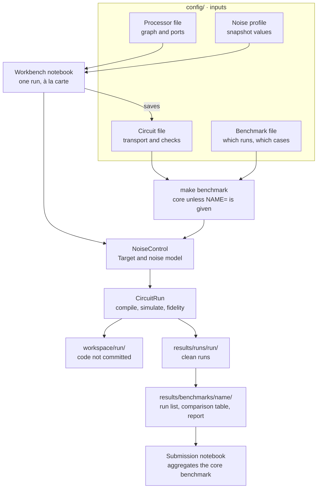

<!-- docs/DESIGN.md -->
# Design

**How the benchmark meets the challenge, and why each part is built the way it is,** for teammates, judges and anyone who runs or extends the benchmark. It assumes Python, some Jupyter and basic linear algebra, but no quantum computing, and each term the design adds is defined where it first appears and collected in [Terms](#terms).

**The design is one flow, drawn below, from the config files to the results the submission shows.**

1. **Four kinds of config file in `config/` hold the inputs:** processor files, noise profiles, circuit files and benchmark files. The workbench saves circuit files, and the other kinds change rarely.
2. **A teammate makes one run in the workbench notebook.** In the **workbench**, they pick a processor and a noise profile by name, build a circuit and save it as a circuit file. A **run** is that circuit on that processor model and noise profile.
3. **`make benchmark` makes many runs at once,** from circuit files and a benchmark file that names the processor and noise pairs each circuit runs on.
4. **Every run passes through two classes.** `NoiseControl` turns the processor file and the noise profile into Qiskit's model of the processor and its noise. `CircuitRun` compiles the circuit, simulates it and computes its fidelity.
5. **A run lands in one of two folders.** A run made with uncommitted changes lands in `workspace/`, which is never committed. A clean run lands in `results/runs/`.
6. **A benchmark gathers its runs** into one comparison table in `results/benchmarks/`. The submission notebook aggregates the **core benchmark**, the [nine cases](CHALLENGE.md#the-nine-core-cases).


`make diagram` renders the figure from the Mermaid source below, so the figure and its source never disagree. Only whoever edits the diagram needs the Mermaid CLI. Everyone else reads the committed PNG.

<details>
<summary>Diagram source (Mermaid)</summary>



</details>

In this file:

| Section | What it covers | Part of the diagram |
|---|---|---|
| [1. Logic in Python, notebooks generated](#1-logic-in-python-notebooks-generated) | Where the logic lives and how both notebooks are made | Workbench notebook, submission notebook |
| [2. Typed configs](#2-typed-configs) | The four kinds of config file | `config/` |
| [3. Processor models](#3-processor-models) | The graphs we use and how we frame them | Processor file |
| [4. Noise model](#4-noise-model) | What a noise profile holds, and what the model leaves out | Noise profile, NoiseControl |
| [5. How a run works](#5-how-a-run-works) | One run, from its inputs to its folder | NoiseControl, CircuitRun, `workspace/`, `results/runs/` |
| [6. Benchmarks and results](#6-benchmarks-and-results) | Sets of runs, and what `results/` holds | `make benchmark`, `results/benchmarks/`, submission notebook |
| [7. Protection as building blocks](#7-protection-as-building-blocks) | How error detection is assembled | Circuit file |
| [8. Metrics and reporting](#8-metrics-and-reporting) | What every result reports | CircuitRun's fidelity, the comparison table |
| [9. Compilation](#9-compilation) | How circuits are compiled and SWAPs counted | CircuitRun's compile step |
| [Terms](#terms) | The design's own terms | Every label |

Related files:

| File | What it holds |
|---|---|
| [CHALLENGE.md](CHALLENGE.md) | The task and its terms |
| [README](../README.md) | Setup and the science rules |
| [`bp.data.references.yaml`](bp.data.references.yaml) | Every source cited here by id |

## 1. Logic in Python, notebooks generated

**All benchmark logic lives in the package, `src/bellbench/`, and both notebooks are generated from it, so no notebook holds logic of its own.** blueprint-render, the repo's renderer for typed YAML, generates each notebook from its process and invoke files, the `bp.process.*` and `bp.invoke.*` files the README's [file naming](../README.md#file-naming) describes.

- **The workbench notebook**, `notebooks/workbench.ipynb`, is where a teammate makes one run ([section 5](#5-how-a-run-works)). It sets values and calls the package, and holds no setup code or benchmark logic.
- **The submission notebook is a separate aggregator,** generated by a process of its own.
  - It gathers the core benchmark's run records, comparison table and diagrams with the package code and the config files, and shows the recorded results.
  - It is shaped like a paper (abstract, methods, results, limitations, recommendation), so we write no separate paper.
  - It runs on Colab or in any environment with the pinned packages.
- **One notebook is an exception:** the exploration notebook made before the hackathon's materials arrived, `src/bellbench/hyperbolic_futures_template.ipynb`, stays in the repo as a record. The benchmark never runs it, and the code ported from it is rewritten in the package.

**Why:**

- **Five people change the code at once.** Python files can be tested and reviewed line by line, where notebook cells are hard to test or diff.
- **Most teammates know Jupyter,** so the workbench lets them run the benchmark without touching setup code.
- **The challenge asks for one reproducible notebook** among the materials ([CHALLENGE.md, What to submit](CHALLENGE.md#what-to-submit)), and the submission notebook is that notebook.

**The submission shows recorded results, and reruns are made from the repo.** A run depends on the git repo in three ways:

- The repo decides where a run is stored.
- It supplies the commit the run records.
- It holds the files a rerun is checked against ([section 5](#5-how-a-run-works)).

A self-contained notebook has none of these, so it shows the results the repo produced instead of producing its own.

## 2. Typed configs

**Every input is a config file, a YAML file in `config/` validated by its schema.** The workbench saves circuit files, the other kinds change rarely, and the code that runs a benchmark only reads them. Four kinds of file cover every input:

| File | Holds | Example |
|---|---|---|
| **Processor file**, `bp.data.processor.*` | Its qubits, each with an id and an optional drawing position, its two ports and its couplers, all named by id; a reference id and notes naming the source | `bp.data.processor.contemporary.yaml`, the organisers' 9-node graph |
| **Noise profile**, `bp.data.noise.*` | One value per noise quantity under a descriptive key, each with a comment saying what it is and its unit, the native gates, and where the values come from ([section 4](#4-noise-model)) | `bp.data.noise.fez-2025.yaml`, medians of an IBM processor's calibration |
| **Circuit file**, `bp.data.circuit.*` | A strategy that works on any processor: the transport, the checks, their timing, and the rule that chooses the path ([section 7](#7-protection-as-building-blocks)) | The baseline transport, with no checks |
| **Benchmark file**, `bp.data.benchmark.*` | Which circuits run on which processor and noise pairs, with the shots and the base seed; for the core benchmark, which run fills which case ([section 6](#6-benchmarks-and-results)) | The core benchmark |

A **transport** builds the part of a circuit that creates the Bell pair and moves it to the ports, and a **check** adds measurements that detect errors along the way ([section 5](#5-how-a-run-works)).

**Each fact lives in one file:**

- **Edges:** a graph's edges are only in its processor file, and the code, the figures and the docs read them from there.
- **The core set:** the organisers' three graphs and the `fez-2025` noise profile. Any other graph or profile, such as `burlington-2020` or the organisers' 2% CX noise, is another file of the same kind, picked by name.
- **Tuned settings:** settings tuned in the workbench, such as a noise scale factor, are recorded in the run's own record, `bp.data.result.*`, which the code writes ([section 5](#5-how-a-run-works)).
- **No schema versions:** a file and its schema change in one commit, and git history versions both.

**Why:**

- **Assumptions are stated and reviewable.** A file states each assumption with its source, as the challenge requires, and a reviewer reads a change to it in a diff.
- **Bad files fail early.** A schema rejects a malformed file before a run starts, and `make bp-validate` checks every typed file.
- **Results trace back.** Every result traces to its files, its seeds and pinned package versions, and reproducibility leads the judging ([CHALLENGE.md, Judging](CHALLENGE.md#judging)).

## 3. Processor models

**The three processor models use the organisers' coupling graphs exactly as their example notebook gives them, because the organisers stated at the event that these graphs are exact.** The graphs, their ports and the hops between the ports are requirements, stated in [CHALLENGE.md, The three processor models](CHALLENGE.md#the-three-processor-models). Every team uses the same ones, and this section records how we use them.


**The organisers' statement:** at the event, the organisers stated that the graphs in their example notebook are exact. The statement has no written source, so this section records it.

- **Each graph is one processor file** in [`config/processor/`](../config/processor/), whose notes cite the notebook cell it comes from. Its positions are the notebook's drawing coordinates, kept as given so the file can be checked against the source, and the figure code fits its drawing to any coordinates. No other file holds an edge list.
- **The figure is ours,** drawn from the processor files, never the organisers' slide, since the repository will be public and the deck is linked, never copied.
- **The contemporary model is the organisers' 9-node graph, not a real IBM layout.** IBM's FakeFez snapshot supplies the noise values and native gates for all three models ([section 4](#4-noise-model)), and FakeFez's own heavy-hex layout runs only in a separate benchmark.
- **The code accepts other graphs as processor files.** A true {7,3} hyperbolic patch, a tiling in which seven-sided cells meet three at each corner, may run in a separate benchmark if time allows. Separate benchmarks stay apart from the core benchmark ([section 6](#6-benchmarks-and-results)).

**The hyperbolic-inspired model is framed by measurable features of one finite graph, never as a hyperbolic advantage.** Our analysis found the 13-node drawing flat or positively curved everywhere. It is a schematic of high-degree, short-distance connectivity rather than a patch of a hyperbolic lattice, so we claim no geometry the graph does not have.

We explain its results by three features:

- **Port distance:** the fewest hops between the ports.
- **Qubit-disjoint paths:** paths between the ports that share no qubit. Three join the hyperbolic-inspired model's ports, two the contemporary model's, and one the 2016-inspired model's.
- **Degree:** the number of edges at a qubit. The hyperbolic-inspired model's centre qubit has six, and the contemporary model's busiest qubit has five.

The future-system recommendation is stated as conditional on the model ([README, science rules](../README.md#science-rules)).

Sources: `ideal-and-noisy-example`, `quanta-challenge-deck`.

## 4. Noise model

**The noise model is ours to choose, and we build it from the median calibration values of real IBM processors.** The values sit in noise profiles that pair with any graph. The challenge still requires the assumptions to be stated and connectivity kept apart from noise ([CHALLENGE.md, Noise is the team's choice](CHALLENGE.md#noise-is-the-teams-choice)), and this section states them.

**The organisers' statement:** at the event, the organisers stated that the noise model is each team's choice. The statement has no written source, so this section records it.

**How the noise model is built:**

1. **`NoiseControl` builds a Qiskit Target** from a processor file and a noise profile. A **Target** is Qiskit's description of a processor: its coupling graph, its **native gates** (the gates it runs directly, into which compilation rewrites every other gate), each gate's duration and error rate, and each qubit's T1 and T2.
2. **Qiskit Aer, the simulator, builds the noise model** from the Target with `NoiseModel.from_backend`.
3. **NoiseControl replaces Aer's readout errors with asymmetric ones.** Aer's are the same in both directions, but the calibration data shows the two misreads differ.

**Everything a snapshot profile holds,** each a single value that every qubit or coupler of the graph takes:

| Quantity | What it means |
|---|---|
| T1 | The time constant, in seconds, with which a qubit's \|1⟩ component decays to \|0⟩ |
| T2 | The time constant, in seconds, with which the off-diagonal entries of a qubit's density matrix decay, losing the phase between \|0⟩ and \|1⟩ |
| Readout errors | The chance of reading 1 for a qubit in \|0⟩, and of reading 0 for a qubit in \|1⟩ |
| Gate error and duration, per native gate | The chance a gate goes wrong each time it runs, and how long it takes; the one-qubit gates apply to every qubit and the two-qubit gate to every coupler |
| Measurement duration | How long reading a qubit takes; its errors are the readout errors |
| Reset duration | How long returning a qubit to \|0⟩ takes; absent when the snapshot has no reset data |
| Time step | The hardware's clock tick, in seconds; null when the snapshot records none |

The key for each value in the files is in the schema, [`config/bp.schema.noise.yaml`](../config/bp.schema.noise.yaml), whose descriptions each file repeats as comments. A depolarising profile, such as the organisers' cross-check, holds one channel instead, as the profiles below describe.

**A noise profile holds one value per quantity, so any profile pairs with any graph.**

- **What it is:** NoiseControl's settings as readable YAML, in Qiskit's units and gate names with descriptive keys such as `t1_relaxation_time` and `reads_1_when_0`.
- **Where its values come from:** each value is the median over a [snapshot's](CHALLENGE.md#the-three-processor-models) qubits and directed couplers, and the profile carries its own native gates.
- **Why one value per quantity:** every qubit and coupler of a graph takes those values, which lets one profile serve all three graphs.

**Per-qubit variation enters only as an override.**

- **Its shape:** an entry naming one qubit, or two for a coupler, a field and a value.
- **What it can change:** T1, T2, both readout errors and a gate's error. Durations cannot be overridden.
- **How it shows:** the run records each override, and its report flags it.

**The profiles, and what each is for:**

- **`fez-2025`, the core default.** Medians of IBM's FakeFez snapshot, calibrated 2025-02-26. The core benchmark runs all three processor models under it, so its comparison shows connectivity alone, as the README's [science rules](../README.md#science-rules) require of any architecture claim. We chose it because it has the most complete data and is current hardware.
- **`burlington-2020`, for an optional study of 2016-era noise.** Medians of FakeBurlingtonV2, calibrated 2020-06-11, the earliest calibration among the snapshots with the T graph.
  - Its gates u1, u2 and u3 are expressed as rz, sx and x, since u2 is one pulse and u3 two.
  - The snapshot records no measurement duration, so the profile borrows FakeOurenseV2's and marks it as borrowed.
  - It has no reset data, so a circuit that resets cannot run on it until a value is chosen.
- **`organiser-cx2`, the cross-check, never the core model.** It applies the organisers' 2% two-qubit depolarising noise after every CX and nothing else, so NoiseControl builds its noise model directly rather than from a Target's error rates.
  - It passes when a run under it reproduces their recorded fidelities ([CHALLENGE.md, The organisers' worked example](CHALLENGE.md#the-organisers-worked-example)), which tests our pipeline against a known answer.
  - Their numbers are exact, so the cross-check computes F exactly from the density matrix. It is the only place an exact F is used ([section 8](#8-metrics-and-reporting)).

Both snapshots are pinned by qiskit-ibm-runtime 0.51.0, and the files in [`config/noise/`](../config/noise/) hold every value with its source.

**Other options:**

- **A different default.** Further research may find a better default than Fez, so the default can change, and every profile stays a file anyone can pick.
- **Optional profiles, if time allows,** each stated as an assumption:
  - **Starting excitation:** a qubit begins a shot partly in |1⟩.
  - **Biased noise:** phase flips outnumber bit flips.
  - **Replacement-type gates.**
- **Considered and rejected:**
  - A profile per processor model in the core benchmark, which would mix connectivity with noise in the comparison.
  - Per-qubit values drawn from the snapshots, which would tie a profile to one processor's layout. Per-qubit variation enters only as an override instead.

**Core channels:**

- **Gate errors:** each gate carries its calibrated error rate.
- **Decay during gates:** T1 and T2 decay over each gate's duration.
- **Decay while idle:** every circuit is scheduled before noise is applied ([README, science rules](../README.md#science-rules)), so waiting becomes timed delays, during which qubits decay.
- **Asymmetric readout errors,** as above. Decay of the measured qubit during measurement is already inside the calibrated misread rates, so it is not added again.

**Conditional channels, only when a strategy needs them:**

- **Reset error and mid-circuit measurement error.** Reset returns a qubit to |0⟩ during the circuit so it can be reused, and a mid-circuit measurement reads a qubit before the end.
  - Both enter as an input of their own and are swept over a range rather than given a claimed value.
  - A run whose circuit resets or measures mid-circuit stops if the matching channel is unset ([section 5](#5-how-a-run-works)).
  - Each channel is built together with the first check that needs it. Until then, setting one raises an error, so a value is never accepted and silently ignored.
- **A degree penalty:** extra error on the hyperbolic-inspired model's centre qubit and the contemporary model's five-edge qubit, entered as an override, only if a strategy routes through them.

**Not modelled, and stated as limitations:**

- **Measurement-induced dephasing:** measuring one qubit disturbs the phase of its neighbours.
- **Always-on ZZ coupling:** neighbouring qubits keep a small interaction when no gate acts.
- **Spectator errors:** a gate disturbs qubits next to the ones it acts on.
- **Coherent errors:** systematic over- or under-rotations, which add up rather than average out.
- **Drift:** calibration values change over time.
- **Leftover excitation:** a qubit not fully back in |0⟩ when the next shot starts.
- **Feedforward latency:** the delay before a circuit can act on a mid-circuit result.
- **Cosmic-ray bursts:** rare events that raise error rates across a chip at once.
- **Leakage:** a qubit leaving the states |0⟩ and |1⟩ for a higher energy level.
- **Frequency crowding:** qubits with close frequencies disturbing each other.

**One scale factor tests whether conclusions hold under stronger or weaker noise.** A noise profile is one assumption, so a conclusion such as "protection pays on this graph" might hold only at that noise level. The noise sweep reruns the same circuits with the noise multiplied by a series of factors, and shows where a conclusion changes and where protection breaks even ([section 6](#6-benchmarks-and-results)).

- **What it scales:** every gate error, both readout error directions and the decay rates 1/T1 and 1/T2. Every duration stays fixed, so each factor runs the same schedule.
- **Its limits:** the factor must be greater than 0, since the ideal simulation already covers no noise. It applies after any overrides, and it also scales a depolarising profile's probability.
- **Invalid values fail loudly:** a scaled value that becomes invalid, such as an error rate above 1, raises an error naming the field instead of being capped, because a capped value would change the model silently.

Sources: `qiskit-fake-provider`, `qiskit-aer-noise-docs`, `ideal-and-noisy-example`, `replacement-type-gates`.

## 5. How a run works

**A run is one circuit on one processor model and noise profile, with its ideal and noisy simulations, and it writes one run folder.** It is the middle of the [flow diagram](#design), from the workbench or `make benchmark` to `workspace/` or `results/runs/`, and it takes eight steps:

1. **Inputs:** the workbench or a benchmark file names a processor file, a noise profile and a circuit file, with any scale factor, overrides and conditional channels ([section 4](#4-noise-model)).
2. **`NoiseControl` builds the processor:** the graph, the ports, the Target and the Aer noise model.
3. **The transport and checks build the circuit** through one build state, described below.
4. **`CircuitRun` compiles once:** it adds each basis's rotation and the port measurement ([CHALLENGE.md, Verifying the pair](CHALLENGE.md#verifying-the-pair)), then compiles the three basis circuits under the run's one transpiler seed ([section 9](#9-compilation)).
5. **`CircuitRun` takes the cost** from the compiled circuit, before scheduling.
6. **`CircuitRun` schedules the circuit,** so that idle time becomes timed delays.
7. **`CircuitRun` simulates** the circuit ideal and noisy, each simulation with its own simulator seed, and computes the fidelity.
8. **`CircuitRun` writes the run folder,** in `results/runs/` or in `workspace/`.

**The build state** is the one object that transports and checks pass along.

- **What it holds:** the circuit, the path the pair takes, the free qubits, and the role of each measured bit, which is a port, a check, or a flag (an extra qubit that catches a fault in the check itself).
- **Who uses it:** a transport creates it from NoiseControl's graph and ports, each check extends it, and the run and the fidelity read it. A transport that needs the router's output, such as one routed by SABRE, may call the compile function itself.
- **Why one object:** it keeps the circuit and its bookkeeping together, so a check knows which qubits are free and the fidelity knows which bits are the ports.

**Rules every run follows:**

- **Compile once per run.** The ideal and noisy simulations share one compiled circuit, so noise is the only difference between them. A SABRE replicate, the same circuit routed under another seed, is a run of its own.
- **Cost before scheduling.** Qubits, ancillas, depth and two-qubit gates come from the compiled circuit before it is scheduled, because scheduling pads every idle qubit with delays. Scheduled duration is a column of its own, and SWAPs are counted as [section 9](#9-compilation) says.
- **Seeds are derived and recorded.** From a base seed, the run derives its transpiler seed and each simulation its simulator seed, and the run records them all, so runs do not share random draws and each can be repeated.
- **Conditional channels are never silently perfect.** A run whose circuit resets a qubit or measures mid-circuit stops if the matching channel is unset.
- **Uncommitted work stays out of `results/`.**
  - A run made while `src/` or `config/` has uncommitted changes writes its folder in `workspace/`, which is never committed.
  - A clean run writes a new folder in `results/runs/`, never edited afterwards.
  - To keep a trial run, commit the change and rerun it, because a result made from code that was never saved cannot be rebuilt.
- **Reruns check themselves.** `CircuitRun.from_yaml` rebuilds a run from its folder, and in doing so it:
  - refuses a referenced file whose content hash has changed (a hash of the parsed YAML, so a comment edit does not count);
  - reports a recompiled circuit that differs from the stored one;
  - uses the recorded simulator method;
  - reports any difference in commit, package versions and numbers.

  A rerun of a core run therefore doubles as its regression check, and `make run RUN=<folder>` makes one without a notebook.

**Both classes load from YAML and export to it.**

- `from_yaml` rebuilds an object, for reproducibility.
- `export_as_yaml` records settings tuned in the workbench.
- Only CircuitRun writes files. NoiseControl's export returns its part of the run's YAML.

The steps inside the classes (compile, schedule, simulate) are plain functions, so each can be tested alone.

**The run folder** holds everything one run produced:

| File | Holds | Role |
|---|---|---|
| Run YAML, `bp.data.result.*` | - The processor, noise and circuit files, by path and content hash<br/>- The scale factor, overrides, conditional channels, shots and seeds<br/>- The circuit as the transport wrote it and as compiled for each basis, in OpenQASM 3 (a text format for circuits) on physical qubits before scheduling, with two-qubit gate counts per edge<br/>- The provenance: commit, package versions, simulator method and result-format version | Rebuilds the run |
| `simulations.csv` | One row of numbers per simulation | The numbers |
| `counts.csv` | The raw measurement counts | Lets the analysis be redone without simulating |
| Diagrams and `report.md` | - The processor graph with its ports and the edges used<br/>- The run's compiled ZZ circuit<br/>- A summary table<br/>- With `diagrams: full` in the workbench, also the written circuit, the XX and YY circuits and the timeline of the schedule | Views, regenerated by `make report` |

## 6. Benchmarks and results

**A benchmark is a named set of runs, defined by a benchmark file, with one comparison table across them.** `make benchmark` runs the core benchmark, the nine cases, and `make benchmark NAME=<name>` runs another. Each benchmark answers one question:

| Benchmark | Runs | Answers |
|---|---|---|
| **Core** | The [nine cases](CHALLENGE.md#the-nine-core-cases), all three processor models under one noise profile, `fez-2025` ([section 4](#4-noise-model)); the benchmark file says which run fills which case | The challenge's comparison of the three processor models, with connectivity the only difference |
| **Noise sweep** | The same circuits at a series of noise scale factors | Whether a conclusion holds as noise grows or shrinks, and where protection breaks even ([section 8](#8-metrics-and-reporting)) |

**Every benchmark other than the core one is an optional study,** in the sense of [CHALLENGE.md, What is fixed and what we choose](CHALLENGE.md#what-is-fixed-and-what-we-choose).

- Its results stay apart from the core benchmark, in a folder of their own.
- The core benchmark already shares one noise profile across the three models, so it is the run any architecture claim rests on ([README, science rules](../README.md#science-rules)).

**`results/` holds clean runs and benchmarks:**

```
results/
  runs/
    <run>/        one clean run, never edited afterwards
  benchmarks/
    <name>/       the benchmark's run list, comparison table and report
workspace/        runtime notebooks and uncommitted runs, never committed
```

- **A benchmark reads only the runs it lists,** so a teammate's trial run never enters its table by accident.
- **Remaking a benchmark replaces its folder and its runs** with fresh ones in one commit, so its table always matches the runs beside it; git history keeps the old ones. Runs made one at a time in the workbench stay until someone deletes them.
- **Each run records a result-format version,** and a benchmark gathers only runs of the current version, so one table never mixes two result shapes.

**Why:** a comparison defined in a file can be reviewed and remade, where a loop in a notebook leaves no record of which runs it compared. The submission notebook reads the core benchmark's folder ([section 1](#1-logic-in-python-notebooks-generated)).

## 7. Protection as building blocks

**Protection is assembled from building blocks in a circuit file, and we choose the core strategy from benchmark results rather than in advance.** Protection here is always error detection with postselection, never error correction or fault tolerance ([README, science rules](../README.md#science-rules)). The strategies the challenge allows are in [CHALLENGE.md, Protection strategies](CHALLENGE.md#protection-strategies).

A strategy is one choice for each block:

- **Transport:** how the pair is created and moved to the ports. The baseline transport follows the organisers' recipe: it moves the pair along the shortest path between the ports with explicit SWAPs, and back.
- **Path selector:** which path between the ports the pair takes.
- **Check type:** one of three.
  - A vacancy check reads a qubit the pair has left and should find it in |0⟩.
  - A ZZ or XX parity check measures Z ⊗ Z or X ⊗ X on the pair through an ancilla.
  - A flagged check adds a flag qubit to catch a fault in the check itself.
- **Check placement:** on the pair's own path, or on a spare path that shares no qubit with it.
- **Check timing:** at the end of the circuit (terminal) or partway through it (mid-circuit).
- **Analysis:** which shots are kept, and the fidelity and acceptance fraction computed from them ([section 8](#8-metrics-and-reporting)).

**Why blocks, chosen later:** choosing a strategy before the benchmark exists gets the order backwards. Blocks let us compare combinations on results. The question we most want to test is whether spare disjoint paths let a pair be checked without mid-circuit measurement.

**The ported checks follow four rules.** The transports and checks are ported from the team's earlier exploration code, and an audit of that code set these rules:

- **Vacancy read before reuse:** a check reuses a qubit of the pair's path only after a vacancy read confirms the qubit is empty, so no leftover state enters the check.
- **Explicit timing:** a check's timing is an explicit, recorded argument, and reset is never assumed perfect ([section 4](#4-noise-model)).
- **Documented blind spots:** each check documents the errors it cannot see, such as a ZZ check missing a phase flip.
- **Single-fault tests:** known-answer tests inject one fault at a time and show which faults each check catches.

A geometry-aware encoding may be the one strategy tested in cases 3, 6 and 9; encodings beyond it are optional studies.

Sources: `smith-2026-error-detected-primitives`, `baumer-2024-long-range-entanglement`, `liao-2025-error-detected-entanglement`, `andersen-2019-parity-stabilization`, `chao-reichardt-2018-flag-qubits`, `siddhu-2025-distillation`.

## 8. Metrics and reporting

**The headline for each case is the pair (F after postselection, acceptance p), set beside the baseline's (F raw, 1), so a gain in fidelity is always read with the shots it discarded.**

- F is the fidelity, and p is the acceptance fraction, the fraction of shots kept ([CHALLENGE.md, Terms](CHALLENGE.md#terms)).
- Every result also reports the challenge's five measures ([CHALLENGE.md, What every result reports](CHALLENGE.md#what-every-result-reports)), with cost taken as [section 5](#5-how-a-run-works) says.

| Reported | How |
|---|---|
| F raw and F after postselection | Each with its statistical uncertainty and the method that computed it |
| Acceptance fraction p | With a Wilson score interval, a confidence interval for a fraction that stays between 0 and 1 |
| Shots | Raw and accepted, for each basis |
| Infidelity removed per unit of rejection | Derived: how much postselection lowers 1 − F for each unit of shots it discards; protection breaks even where this crosses zero in a noise sweep |
| Two-qubit gates per accepted pair | Derived: the two-qubit gate cost of each pair that survives postselection |

- **One fidelity function** computes F raw and F after postselection from the three correlators. Every result reports F measured from shots; an exact F, from the density matrix's correlators, only reproduces the organisers' numbers ([section 4](#4-noise-model)).
- **A protected run takes more shots,** in proportion to 1/p, so it keeps about as many accepted shots as its baseline.
- **The analysis warns when a basis keeps no shots,** because that basis's correlator, and so F, is then undefined.
- **No readout mitigation in the core benchmark** ([README, science rules](../README.md#science-rules)): runs use the simulator's standard measurement, so p stays the plain fraction of shots kept.

**Why:** published error-detection experiments report postselected fidelity the same way, beside the raw fidelity and the acceptance rate, and the form lets a reader judge whether protection pays for its discarded shots, as the challenge asks ([CHALLENGE.md, Interpreting the comparison](CHALLENGE.md#interpreting-the-comparison)).

Source: `smith-2026-error-detected-primitives`.

## 9. Compilation

**Circuits are written on physical qubits and compiled at optimisation level 1, because from level 2 up Qiskit deletes explicit SWAPs.** Compilation rewrites a circuit into the processor's native gates and coupling graph ([CHALLENGE.md, Interpreting the comparison](CHALLENGE.md#interpreting-the-comparison)).

From level 2 up, Qiskit's ElidePermutations pass deletes SWAPs and relabels the outputs instead, so the pair would never physically reach the ports. The benchmark measures the cost of moving the pair, so the compiler must not optimise the move away, and every run records whether the pair ended on the ports.

- **Physical qubits:** a circuit names the processor's own qubits, so the ports stay where the challenge puts them and the layout is our choice, not the compiler's.
- **SABRE over several seeds:** SABRE, Qiskit's routing heuristic, finds different routes under different seeds, so routing that relies on it runs over several seeds. Each seed is a run of its own, a SABRE replicate, and a SABRE transport brings the pair back to the ports.
- **SWAPs counted where they exist:** the SWAP count is the SWAPs the transport wrote plus those the router added, taken before compilation turns each SWAP into three two-qubit gates. Depth and two-qubit gate counts come from the compiled circuit.

Source: `fallfest-compilation-deck`.

## Terms

This table collects the design's own terms, each defined where it first appears above. The challenge's terms are CHALLENGE.md's: [case](CHALLENGE.md#terms), [port](CHALLENGE.md#terms), [fidelity](CHALLENGE.md#terms), [processor model](CHALLENGE.md#the-three-processor-models), [noise model](CHALLENGE.md#noise-is-the-teams-choice) and [shot](CHALLENGE.md#verifying-the-pair).

| Term | Means |
|---|---|
| Benchmark | A named set of runs, defined by a benchmark file, with one comparison table across them. Bare, "the benchmark" means this whole project; "the core benchmark" means the nine cases; every other benchmark is named, such as the noise sweep. |
| Benchmark file | A YAML file in `config/` that names which circuits run on which processor and noise pairs, with the shots and the base seed. Not the benchmark's results, which are in `results/benchmarks/`. |
| Check | A function that extends the build state with measurements that detect errors, such as a parity check on the pair. |
| Build state | The object that transports and checks pass along while a circuit is built: the circuit, the path, the free qubits and the role of each measured bit. |
| Circuit file | A YAML file in `config/` holding one strategy: the transport, the checks, their timing and the rule that chooses the path. It works on any processor, unlike a compiled circuit, which belongs to one. |
| Comparison table | A benchmark's table across its runs, with the derived metrics of [section 8](#8-metrics-and-reporting). |
| Noise profile | The file of values a noise model is built from: one value per quantity and a native gate set, in Qiskit's units and gate names with descriptive keys. The noise model is what NoiseControl builds from it. |
| Run | One circuit on one processor model and noise profile, with its simulations; it writes one run folder. A SABRE replicate is a run of its own. |
| Run folder | The folder one run writes: in `results/runs/` for a clean run, in `workspace/` for a run made with uncommitted changes. |
| Simulation | One execution of the simulator on a run's compiled circuit, either ideal or noisy, and later also a replicate for statistics. Not a run: one run holds several simulations. |
| Target | Qiskit's description of a processor: its coupling graph, native gates, each gate's duration and error rate, and each qubit's T1 and T2. NoiseControl builds it from a processor file and a noise profile. |
| Transport | A function that creates the build state: it builds the part of a circuit that makes the Bell pair and moves it to the ports. |
| Workbench | The notebook `notebooks/workbench.ipynb`, copied into `workspace/`, that makes one run at a time. |
