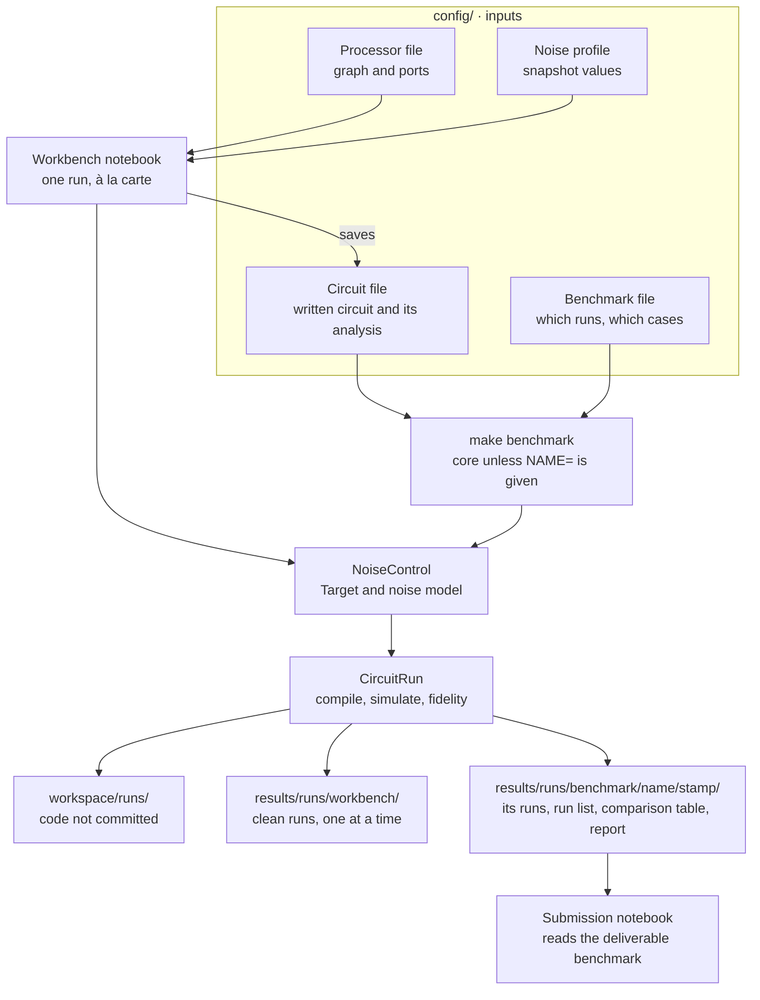
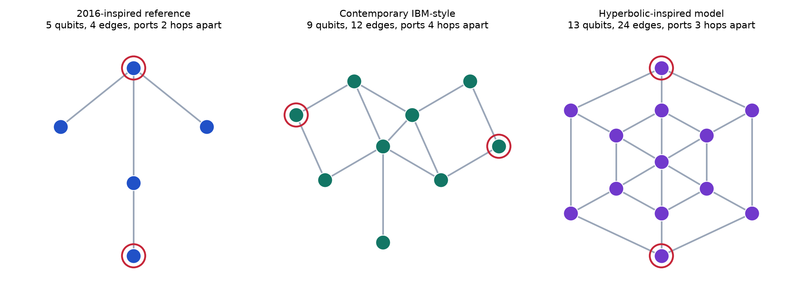

<!-- docs/DESIGN.md -->
# Design

**How the benchmark meets the challenge, and why each part is built the way it is,** for teammates, judges and anyone who runs or extends the benchmark. It assumes Python, some Jupyter and basic linear algebra, but no quantum computing, and each term the design adds is defined where it first appears and collected in [Terms](#terms).

**The design is one flow, drawn below, from the config files to the results the submission shows.**

1. **Four kinds of config file in `config/` hold the inputs:** processor files, noise profiles, circuit files and benchmark files. The workbench saves circuit files, and the other kinds change rarely.
2. **A teammate makes one run in the workbench notebook.** In the **workbench**, they pick a processor and a noise profile by name, build a circuit and save it as a circuit file. A **run** is that circuit on that processor model and noise profile.
3. **`make benchmark` makes many runs at once,** from a benchmark file that names, for each run, a circuit file and a noise profile.
4. **Every run passes through two classes.** `NoiseControl` turns the processor file and the noise profile into Qiskit's model of the processor and its noise. `CircuitRun` compiles the circuit, simulates it and computes its fidelity.
5. **A run lands in one of two folders.** A run made with uncommitted changes lands in `workspace/`, which is never committed. A clean run lands in `results/runs/`.
6. **A benchmark makes its runs in one folder,** with one comparison table across them. The submission reports the **deliverable benchmark**, `deliverable-2026-11-17`, which fills the challenge's [nine cases](CHALLENGE.md#the-nine-core-cases) ([section 6](#6-benchmarks-and-results)).


`make diagram` renders the figure from the Mermaid source below, so the figure and its source never disagree. Only whoever edits the diagram needs the Mermaid CLI. Everyone else reads the committed PNG.

<details>
<summary>Diagram source (Mermaid)</summary>



</details>

In this file:

| Section | What it covers | Part of the diagram |
|---|---|---|
| [1. Logic in Python, notebooks generated](#1-logic-in-python-notebooks-generated) | Where the logic lives and how both notebooks are made | Workbench notebook, submission notebook |
| [2. Typed configs](#2-typed-configs) | The four kinds of config file | `config/` |
| [3. Processor models](#3-processor-models) | The graphs we use and how we frame them | Processor file |
| [4. Noise model](#4-noise-model) | What a noise profile holds, and what the model leaves out | Noise profile, NoiseControl |
| [5. How a run works](#5-how-a-run-works) | One run, from its inputs to its folder | NoiseControl, CircuitRun, `workspace/`, `results/runs/` |
| [6. Benchmarks and results](#6-benchmarks-and-results) | Sets of runs, and what `results/` holds | `make benchmark`, `results/runs/benchmark/`, submission notebook |
| [7. Protection as building blocks](#7-protection-as-building-blocks) | How error detection is assembled | Circuit file |
| [8. Metrics and reporting](#8-metrics-and-reporting) | What every result reports | CircuitRun's fidelity, the comparison table |
| [9. Compilation](#9-compilation) | How circuits are compiled and SWAPs counted | CircuitRun's compile step |
| [Terms](#terms) | The design's own terms | Every label |

Related files:

| File | What it holds |
|---|---|
| [CHALLENGE.md](CHALLENGE.md) | The task and its terms |
| [README](../README.md) | Setup and the science rules |
| [`bp.data.references.yaml`](bp.data.references.yaml) | Every source cited here by id |

## 1. Logic in Python, notebooks generated

**All benchmark logic lives in the package, `src/bellbench/`, and both notebooks are generated from it, so no notebook holds logic of its own.** blueprint-render, the repo's renderer for typed YAML, generates each notebook from its process and invoke files, the `bp.process.*` and `bp.invoke.*` files the README's [file naming](../README.md#file-naming) describes.

- **The workbench notebook** is where a teammate makes one run ([section 5](#5-how-a-run-works)). It is generated as `notebooks/bp.output.workbench.ipynb`, and each teammate runs a copy of their own in `workspace/` ([`workspace/README.md`](../workspace/README.md)). It sets values and calls the package, and holds no setup code or benchmark logic.
- **The submission notebook is a separate aggregator,** generated as `notebooks/bp.output.submission.ipynb` by `make submission`, from its own process, invoke and template.
  - It shows the recorded results of the deliverable benchmark's snapshot, which fills the nine cases, and of the three extended benchmarks, which set each protected case beside the circuits one step from it, each a snapshot its invoke names. Every number in its text comes from their run records when it is rendered, and `tests/test_submission.py` checks that each claim its text makes still holds for those snapshots.
  - It reads like a paper, so we write no separate paper: an overview, a walkthrough of how the package makes a run, the task, the configuration with its limitations, the results with their interpretation and recommendation, and the alternative circuits.
  - It runs on Colab or in any environment with the pinned packages, with no copy of the repo. It carries four payloads, each file listed with its SHA-256 so it can be checked against the repo at the tag the invoke names: the package (`src/bellbench/`), the deliverable benchmark's recorded runs, the extended benchmarks' recorded runs, and the schemas with the core benchmark file, shown folded. It writes every other config file out, readable, where it explains it.
- **One notebook is an exception:** the exploration notebook made before the hackathon's materials arrived, `src/bellbench/hyperbolic_futures_template.ipynb`, stays in the repo as a record. The benchmark never runs it, and the code ported from it is rewritten in the package.

**Why:**

- **Five people change the code at once.** Python files can be tested and reviewed line by line, where notebook cells are hard to test or diff.
- **Most teammates know Jupyter,** so the workbench lets them run the benchmark without touching setup code.
- **The challenge asks for one reproducible notebook** among the materials ([CHALLENGE.md, What to submit](CHALLENGE.md#what-to-submit)), and the submission notebook is that notebook.

**The submission remakes every run it reports and sets each beside the run the repo recorded; the repo's runs stay the record.** A run depends on the git repo in three ways:

- The repo decides where a run is stored.
- It supplies the commit the run records.
- It holds the files a rerun is checked against ([section 5](#5-how-a-run-works)).

A self-contained notebook has none of these, so its runs are checks, not records. It makes every benchmark it reports from the config files it writes out, then compares each run with the recorded one: counts, compiled circuits and numbers agree, and only the commit, which cannot match outside the repo, differs.

## 2. Typed configs

**Every input is a config file, a YAML file in `config/` validated by its schema.** The workbench saves circuit files, the other kinds change rarely, and the code that runs a benchmark only reads them. Four kinds of file cover every input:

| File | Holds | Example |
|---|---|---|
| **Processor file**, `bp.data.processor.*` | Its qubits, each with an id and an optional drawing position, its two ports and its couplers, all named by id; a reference id and notes naming the source | `bp.data.processor.contemporary.yaml`, the organisers' 9-node graph |
| **Noise profile**, `bp.data.noise.*` | One value per noise quantity under a descriptive key, each with a comment saying what it is and its unit, the native gates, and where the values come from ([section 4](#4-noise-model)) | `bp.data.noise.fez-2025.yaml`, medians of an IBM processor's calibration |
| **Circuit file**, `bp.data.circuit.*` | One written circuit, in OpenQASM 3 on one named processor's physical qubits; the analysis that reads its shots; and notes on how it was built, such as the transport, the checks and the path ([section 7](#7-protection-as-building-blocks)) | The baseline transport on the 2016-inspired graph, with no checks |
| **Benchmark file**, `bp.data.benchmark.*` | Its runs, each a circuit file under a noise profile with any scale factor, overrides and conditional channels; the shots and the base seed; and, where it fills the challenge's cases, which run and simulation fills each ([section 6](#6-benchmarks-and-results)) | The move-chain benchmark |

A **transport** builds the part of a circuit that creates the Bell pair and moves it to the ports, and a **check** adds measurements that detect errors along the way ([section 5](#5-how-a-run-works)).

**Each fact lives in one file:**

- **Edges:** a graph's edges are only in its processor file, and the code, the figures and the docs read them from there.
- **The core set:** the organisers' three graphs and the core noise profile ([section 4](#4-noise-model)). Any other graph or profile, such as `burlington-2020` or the organisers' 2% CX noise, is another file of the same kind, picked by name.
- **Tuned settings:** settings tuned in the workbench, such as a noise scale factor, are recorded in the run's own record, `bp.data.result.*`, which the code writes ([section 5](#5-how-a-run-works)).
- **No schema versions:** a file and its schema change in one commit, and git history versions both.

**Why:**

- **Assumptions are stated and reviewable.** A file states each assumption with its source, as the challenge requires, and a reviewer reads a change to it in a diff.
- **Bad files fail early.** A schema rejects a malformed file before a run starts, and `make bp-validate` checks every typed file.
- **Results trace back.** Every result traces to its files, its seeds and pinned package versions, and reproducibility leads the judging ([CHALLENGE.md, Judging](CHALLENGE.md#judging)).

## 3. Processor models

**The three processor models use the organisers' coupling graphs exactly as their example notebook gives them, because the organisers stated at the event that these graphs are exact.** The graphs, their ports and the hops between the ports are requirements, stated in [CHALLENGE.md, The three processor models](CHALLENGE.md#the-three-processor-models). Every team uses the same ones, and this section records how we use them.



**The organisers' statement:** at the event, the organisers stated that the graphs in their example notebook are exact. The statement has no written source, so this section records it.

- **Each graph is one processor file** in [`config/processor/`](../config/processor/), whose notes cite the notebook cell it comes from. Its positions are the notebook's drawing coordinates, kept as given so the file can be checked against the source, and the figure code fits its drawing to any coordinates. No other file holds an edge list.
- **The figure is ours,** drawn from the processor files, never the organisers' slide, since the repository will be public and the deck is linked, never copied.
- **The contemporary model is the organisers' 9-node graph, not a real IBM layout.** The core noise profile, the medians of an IBM snapshot, supplies the noise values and native gates for all three models ([section 4](#4-noise-model)). A snapshot's own heavy-hex layout would run only in a separate benchmark, and none is built.
- **The code accepts other graphs as processor files.** A true {7,3} hyperbolic patch, a tiling in which seven-sided cells meet three at each corner, may run in a separate benchmark if time allows. Separate benchmarks stay apart from the core benchmark ([section 6](#6-benchmarks-and-results)).

**The hyperbolic-inspired model is framed by measurable features of one finite graph, never as a hyperbolic advantage.** Our analysis found the 13-node drawing flat or positively curved everywhere. It is a schematic of high-degree, short-distance connectivity rather than a patch of a hyperbolic lattice, so we claim no geometry the graph does not have.

We explain its results by three features:

- **Port distance:** the fewest hops between the ports.
- **Qubit-disjoint paths:** paths between the ports that share no qubit. Three join the hyperbolic-inspired model's ports, two the contemporary model's, and one the 2016-inspired model's.
- **Degree:** the number of edges at a qubit. The hyperbolic-inspired model's centre qubit has six, and the contemporary model's busiest qubit has five.

The future-system recommendation is stated as conditional on the model ([README, science rules](../README.md#science-rules)).

Sources: `ideal-and-noisy-example`, `quanta-challenge-deck`.

## 4. Noise model

**The noise model is ours to choose, and we build it from the median calibration values of real IBM processors.** The values sit in noise profiles that pair with any graph. The challenge still requires the assumptions to be stated and connectivity kept apart from noise ([CHALLENGE.md, Noise is the team's choice](CHALLENGE.md#noise-is-the-teams-choice)), and this section states them.

**The organisers' statement:** at the event, the organisers stated that the noise model is each team's choice. The statement has no written source, so this section records it.

**There are three kinds of noise profile.** A **snapshot** profile holds an IBM processor's calibration medians, and its model is built in three steps, below. A **depolarising** profile and a **pauli** profile each hold one error after one named gate, as their entries in the list of profiles describe.

**How a snapshot profile's model is built:**

1. **`NoiseControl` builds a Qiskit Target** from a processor file and a noise profile. A **Target** is Qiskit's description of a processor: its coupling graph, its **native gates** (the gates it runs directly, into which compilation rewrites every other gate), each gate's duration and error rate, and each qubit's T1 and T2.
2. **Qiskit Aer, the simulator, builds the noise model** from the Target with `NoiseModel.from_backend`.
3. **NoiseControl replaces Aer's readout errors with asymmetric ones.** Aer's are the same in both directions, but the calibration data shows the two misreads differ.

**Everything a snapshot profile holds,** each a single value that every qubit or coupler of the graph takes:

| Quantity | What it means |
|---|---|
| T1 | The time constant, in seconds, with which a qubit's \|1⟩ component decays to \|0⟩ |
| T2 | The time constant, in seconds, with which the off-diagonal entries of a qubit's density matrix decay, losing the phase between \|0⟩ and \|1⟩ |
| Readout errors | The chance of reading 1 for a qubit in \|0⟩, and of reading 0 for a qubit in \|1⟩ |
| Gate error and duration, per native gate | The chance a gate goes wrong each time it runs, and how long it takes; the one-qubit gates apply to every qubit and the two-qubit gate to every coupler |
| Measurement duration | How long reading a qubit takes; its errors are the readout errors |
| Reset duration | How long returning a qubit to \|0⟩ takes; absent when the snapshot has no reset data |
| Time step | The hardware's clock tick, in seconds; null when the snapshot records none |

The key for each value in the files is in the schema, [`config/bp.schema.noise.yaml`](../config/bp.schema.noise.yaml), whose descriptions each file repeats as comments. A depolarising or pauli profile holds its one error and its gate set instead, with no readout error, no decay and no durations, so a circuit run under it is not scheduled.

**A noise profile holds one value per quantity, so any profile pairs with any graph.**

- **What it is:** NoiseControl's settings as readable YAML, in Qiskit's units and gate names with descriptive keys such as `t1_relaxation_time` and `reads_1_when_0`.
- **Where its values come from:** each value is the median over a [snapshot's](CHALLENGE.md#the-three-processor-models) qubits and directed couplers, and the profile carries its own native gates.
- **Why one value per quantity:** every qubit and coupler of a graph takes those values, which lets one profile serve all three graphs.

**Per-qubit variation enters only as an override.**

- **Its shape:** an entry naming one qubit, or two for a coupler, a field and a value.
- **What it can change:** T1, T2, both readout errors and a gate's error. Durations cannot be overridden.
- **How it shows:** the run records each override, and its report flags it.

**The profiles, and what each is for:**

- **`boston-2026`, the core default.** Medians of IBM's FakeBoston snapshot (Heron r3), calibrated 2026-04-17. Every benchmark that compares the three processor models runs them all under it, so the comparison shows connectivity alone, as the README's [science rules](../README.md#science-rules) require of any architecture claim. We chose it because it is the newest calibration among the pinned snapshots and holds every value a profile needs.
- **`fez-2025`, the earlier default.** Medians of IBM's FakeFez snapshot (Heron r2), calibrated 2025-02-26, kept as a profile anyone can pick.
- **`burlington-2020`, for an optional study of 2016-era noise.** Medians of FakeBurlingtonV2, calibrated 2020-06-11, the earliest calibration among the snapshots with the T graph.
  - Its gates u1, u2 and u3 are expressed as rz, sx and x, since u2 is one pulse and u3 two.
  - The snapshot records no measurement duration, so the profile borrows FakeOurenseV2's and marks it as borrowed.
  - It has no reset data, so a circuit that resets cannot run on it until a value is chosen.
- **`organiser-cx2`, the cross-check, never the core model.** It applies the organisers' 2% two-qubit depolarising noise after every CX and nothing else, so NoiseControl builds its noise model directly rather than from a Target's error rates.
  - Tests run the organisers' recipe on each graph under it and reproduce their recorded fidelities ([CHALLENGE.md, The organisers' worked example](CHALLENGE.md#the-organisers-worked-example)), which tests our pipeline against a known answer.
  - Their numbers are exact, so the cross-check computes F exactly from the density matrix. It is the only place an exact F is used ([section 8](#8-metrics-and-reporting)).
- **`pauli-cx-biased`, `pauli-cz-biased` and `pauli-cx-unbiased`, for the biased-noise study, never the core model.** After each use of the named two-qubit gate, each qubit it acts on independently takes an X, Y or Z error with total probability p = 0.00942, split by the noise bias η = p_Z / (p_X + p_Y): 100 in the two biased profiles and 0.5, unbiased, in the third.
  - The value of p makes a two-qubit gate's total error, 1 − (1 − p)², about 0.0188, the error `organiser-cx2`'s 2% depolarising channel applies.
  - The two biased profiles differ in the native two-qubit gate. With CX native, a phase flip stays a phase flip through the gate; with CZ native, a CX compiles to H, CZ and H, and the second H turns a phase flip on the target into a bit flip.
  - Every other gate is ideal.

The three snapshots are pinned by qiskit-ibm-runtime 0.51.0, and the files in [`config/noise/`](../config/noise/) hold every value with its source.

**Other options:**

- **A different default.** Further research may find a better default than Boston, so the default can change, and every profile stays a file anyone can pick.
- **An optional profile, if time allows:** replacement-type gates, stated as an assumption.
- **Considered and rejected:**
  - A profile per processor model in the core benchmark, which would mix connectivity with noise in the comparison.
  - Per-qubit values drawn from the snapshots, which would tie a profile to one processor's layout. Per-qubit variation enters only as an override instead.

**Core channels:**

- **Gate errors:** each gate carries its calibrated error rate.
- **Decay during gates:** T1 and T2 decay over each gate's duration.
- **Decay while idle:** every circuit run under a snapshot profile is scheduled before noise is applied ([README, science rules](../README.md#science-rules)), so waiting becomes timed delays, during which qubits decay.
- **Asymmetric readout errors,** as above. Decay of the measured qubit during measurement is already inside the calibrated misread rates, so it is not added again.

**Conditional channels, set per run rather than by the profile:**

- **Reset error and mid-circuit measurement error.** Reset returns a qubit to |0⟩ during the circuit so it can be reused, and a mid-circuit measurement reads a qubit before the end.
  - Both enter as an input of their own and are swept over a range rather than given a claimed value.
  - A run whose circuit resets or measures mid-circuit stops if the matching channel is unset ([section 5](#5-how-a-run-works)).
  - **A measurement is mid-circuit only when its qubit is acted on again,** by a gate, a measurement or a reset. A measurement with nothing after it on its qubit is final and needs no channel, which lets a check on a spare path read at the end with none set.
  - The mid-circuit channel applies under every kind of profile, and the reset channel only under a snapshot profile with reset data. The scale factor leaves both alone, and the mid-circuit sweep sweeps the second ([section 6](#6-benchmarks-and-results)).
  - A value is never accepted and silently ignored: setting a reset error on a profile that defines no reset raises an error, and so does a profile that lists reset among its gates.
- **Starting excitation:** the chance that each qubit starts a shot in |1⟩ instead of |0⟩, whether from heat or left over from the shot before, entered as `starting_excitation` and swept over a range by the starting-excitation study ([section 6](#6-benchmarks-and-results)).
  - Once the circuit is scheduled, a labelled marker opens every qubit, before any idle delay, and the noise model flips the qubit there with that chance, so an excited qubit decays while it waits. It applies under every kind of profile, and the scale factor leaves it alone.
  - Unlike the other two, it does not depend on what a circuit does, since every circuit starts: unset means no excitation, the model's assumption everywhere else, and stops no run.
  - A run records it only when set, so a run without it keeps the record and seeds it would have had without the channel; a run whose circuits the marker would not reach stops.
  - The reported strategy, the move chain and the spare-path checks rely on its absence ([section 7](#7-protection-as-building-blocks)).
- **A degree penalty, planned:** extra error on the hyperbolic-inspired model's centre qubit and the contemporary model's five-edge qubit, entered as an override, only if a strategy routes through them. No run carries one yet. The nine cases avoid the contemporary model's five-edge qubit. The extended benchmarks' spare-path XX checks on the contemporary model, the move-chain benchmark's protected case there and the vacancy-read study's run there read their XX checks through it, and the middle-out study's ZZ and XX run reads its XX check through the centre qubit, so their numbers are without the penalty, a limitation of those numbers.

**Not modelled, and stated as limitations:**

- **Measurement-induced dephasing:** measuring one qubit disturbs the phase of its neighbours.
- **Always-on ZZ coupling:** neighbouring qubits keep a small interaction when no gate acts.
- **Spectator errors:** a gate disturbs qubits next to the ones it acts on.
- **Coherent errors:** systematic over- or under-rotations, which add up rather than average out.
- **Drift:** calibration values change over time.
- **Feedforward latency:** the delay before a circuit can act on a mid-circuit result.
- **Cosmic-ray bursts:** rare events that raise error rates across a chip at once.
- **Leakage:** a qubit leaving the states |0⟩ and |1⟩ for a higher energy level.
- **Frequency crowding:** qubits with close frequencies disturbing each other.

**One scale factor tests whether conclusions hold under stronger or weaker noise.** A noise profile is one assumption, so a conclusion such as "protection pays on this graph" might hold only at that noise level. A noise sweep, planned, would rerun the same circuits with the noise multiplied by a series of factors, and show where a conclusion changes and where protection breaks even ([section 6](#6-benchmarks-and-results)).

- **What it scales:** every gate error, both readout error directions and the decay rates 1/T1 and 1/T2. Every duration stays fixed, so each factor runs the same schedule.
- **Its limits:** the factor must be greater than 0, since the ideal simulation already covers no noise. It applies after any overrides, and it also scales a depolarising or pauli profile's probability, leaving a pauli profile's bias alone.
- **Invalid values fail loudly:** a scaled value that becomes invalid, such as an error rate above 1, raises an error naming the field instead of being capped, because a capped value would change the model silently.

Sources: `qiskit-fake-provider`, `qiskit-aer-noise-docs`, `ideal-and-noisy-example`, `puri-2020-bias-preserving-cx`, `replacement-type-gates`.

## 5. How a run works

**A run is one circuit on one processor model and noise profile, with its ideal and noisy simulations, and it writes one run folder.** It is the middle of the [flow diagram](#design), from the workbench or `make benchmark` to `workspace/` or `results/runs/`, and it takes eight steps:

1. **Inputs:** the workbench or a benchmark file names a circuit file, which names its processor, and a noise profile, with any scale factor, overrides and conditional channels ([section 4](#4-noise-model)).
2. **`NoiseControl` builds the processor:** the graph, the ports, the Target and the Aer noise model.
3. **`CircuitRun` loads the circuit file:** its written circuit and the analysis that reads its shots, checked against the processor's qubits and ports and the roles of its registers.
4. **`CircuitRun` compiles once:** it adds each basis's rotation and the port measurement ([CHALLENGE.md, Verifying the pair](CHALLENGE.md#verifying-the-pair)), then compiles the three basis circuits under the run's one transpiler seed ([section 9](#9-compilation)).
5. **`CircuitRun` takes the cost** from the compiled circuit, before scheduling.
6. **`CircuitRun` schedules the circuit,** so that idle time becomes timed delays.
7. **`CircuitRun` simulates** the circuit ideal and noisy, each simulation with its own simulator seed, and computes the fidelity.
8. **`CircuitRun` writes the run folder,** in `results/runs/` or in `workspace/`.

**A circuit file is built before any run, through one build state.** In the workbench, a transport starts the build state from a processor file and a path between its ports, each check extends it, and saving it writes the circuit file with the analysis the builders wrote. A run then reads only that file ([section 7](#7-protection-as-building-blocks)).

- **What it holds:** the circuit, the path the pair takes, the qubits known to be in |0⟩, and each measured bit with its role, a check, a flag (an extra qubit that catches a fault in the check itself) or a Pauli frame, and its analysis settings. The run adds the ports' measurement itself.
- **Why one object:** it keeps the circuit and its bookkeeping together, so a check knows which qubits are free and the circuit file records how each bit is read.

**Rules every run follows:**

- **Compile once per run.** The ideal and noisy simulations share one compiled circuit, so noise is the only difference between them. A SABRE replicate, planned, the same circuit routed under another seed, would be a run of its own.
- **Cost before scheduling.** Qubits, ancillas, depth and two-qubit gates come from the compiled circuit before it is scheduled, because scheduling pads every idle qubit with delays. Scheduled duration is a column of its own, and SWAPs are counted as [section 9](#9-compilation) says.
- **Seeds are derived and recorded.** From a base seed, the run derives its transpiler seed and each simulation its simulator seed, and the run records them all, so runs do not share random draws and each can be repeated.
- **Conditional channels are never silently perfect.** A run whose circuit resets a qubit or measures mid-circuit stops if the matching channel is unset.
- **Uncommitted work stays out of `results/`.**
  - A run made while `src/` or `config/` has uncommitted changes writes its folder in `workspace/`, which is never committed.
  - A clean run writes a new folder in `results/runs/`, never edited afterwards.
  - To keep a trial run, commit the change and rerun it, because a result made from code that was never saved cannot be rebuilt.
- **Reruns check themselves.** `CircuitRun.from_yaml` rebuilds a run from its folder, and in doing so it:
  - refuses a referenced file whose content hash has changed (a hash of the parsed YAML, so a comment edit does not count);
  - reports a recompiled circuit that differs from the stored one;
  - uses the recorded simulator method;
  - reports any difference in commit, package versions and numbers.

  A rerun of a core run therefore doubles as its regression check, and `make run RUN=<folder>` makes one without a notebook.

**Both classes load from YAML and export to it.**

- `from_yaml` rebuilds an object, for reproducibility.
- `export_as_yaml` records settings tuned in the workbench.
- Only CircuitRun writes files. NoiseControl's export returns its part of the run's YAML.

The steps inside the classes (compile, schedule, simulate) are plain functions, so each can be tested alone.

**The run folder** holds everything one run produced:

| File | Holds | Role |
|---|---|---|
| Run YAML, `bp.data.result.*` | - The processor, noise and circuit files, by path and content hash<br/>- The scale factor, overrides, conditional channels, shots and seeds<br/>- The circuit as the transport wrote it and as compiled for each basis, in OpenQASM 3 (a text format for circuits) on physical qubits before scheduling, with two-qubit gate counts per edge<br/>- The provenance: commit, package versions, simulator method and result-format version | Rebuilds the run |
| `simulations.csv` | One row of numbers per simulation | The numbers |
| `counts.csv` | The raw measurement counts | Lets the analysis be redone without simulating |
| Diagrams and `report.md` | - `graph.png`: the processor graph with its ports and the edges used<br/>- `written/`, `compiled/` and `timeline/`, each holding `zz.png`, `xx.png` and `yy.png`, one per reading: the circuit as written with that reading's basis change and port measurement, the same circuit compiled, and the compiled circuit's schedule. A noise profile without durations has no `timeline/`<br/>- A summary table<br/>- Every run folder holds this same set, a benchmark's and a workbench run's alike | Views, regenerated by `make report` |

## 6. Benchmarks and results

**A benchmark is a named set of runs, defined by a benchmark file, with one comparison table across them.** `make benchmark` makes the core benchmark, and `make benchmark NAME=<name>` makes another. Eleven are built, and each answers one question:

| Benchmark | Runs | Answers |
|---|---|---|
| **Core**, `core` | The organisers' baseline on each processor model, under the core noise profile ([section 4](#4-noise-model)). It fills the ideal and noisy [cases](CHALLENGE.md#the-nine-core-cases), 1, 2, 4, 5, 7 and 8, and leaves the protected cases 3, 6 and 9 open | How the three processor models compare, with connectivity the only difference |
| **Deliverable**, `deliverable-2026-11-17` | All nine cases under the core noise profile, at 100,000 shots per basis. The ideal and noisy cases are the organisers' baseline, as the core runs it; the protected cases are GHZ disentangling followed by a vacancy read ([section 7](#7-protection-as-building-blocks)). It runs only the runs that fill a case | The nine cases with the reported strategy. **The submission reports this benchmark's nine cases** |
| **Extended**, `deliverable-2026-11-17-extended-<processor>`, one per processor model | The graph's protected case beside the circuits one step from it: the baseline, the move chain, the textbook GHZ transport, also with no readout error on the qubits it reads, GHZ disentangling alone, each of the two transports followed by a vacancy read, and the earlier XX checks, all at the deliverable's profile, shots and base seed. None fills a case | What each one change from the protected case buys, on each graph |
| **Move chain**, `move-chain` | All nine cases under the core noise profile. The ideal and noisy cases are the core's baseline runs, with the same circuits, profile and seeds, so the same numbers; the protected cases are the move chain with its XX check ([section 7](#7-protection-as-building-blocks)). The move chain also runs alone, filling no case | What the move chain's cheaper transport buys, and what its check buys, on each graph. The submission reported this benchmark's nine cases before it reported the deliverable benchmark's |
| **Biased noise**, `biased-noise` | The baseline, the move chain and the move chain with its XX check on each graph, under three pauli profiles ([section 4](#4-noise-model)) | An optional study: whether an XX check catches nearly every error when a processor's errors are mostly phase flips |
| **Mid-circuit sweep**, `mid-circuit-sweep` | The move chain with its XX check on the 2016-inspired model's path, at mid-circuit measurement errors 0, 0.001, 0.003, 0.01, 0.02 and 0.05, beside the baseline and the move chain alone, once each; its run at 0.01 repeats case 3 | An optional study: how much case 3 depends on the mid-circuit measurement error it assumes, and at which values, if any, the check beats the move chain alone |
| **Starting excitation**, `starting-excitation` | The move-chain benchmark's nine runs at starting excitations 0, 0.005, 0.01 and 0.02 ([section 4](#4-noise-model)) | An optional study: how fast the move chain's and the spare-path checks' lead shrinks when qubits may start a shot in \|1⟩ ([section 7](#7-protection-as-building-blocks)) |
| **Middle out**, `middle-out` | Middle-out, with and without the XX check, on the contemporary and hyperbolic models, and on the hyperbolic model a ZZ check before the XX check, each beside the move-chain benchmark's run it varies, with the same circuit, profile and seeds ([section 7](#7-protection-as-building-blocks)) | An optional study: whether moving both halves of the pair at once, or adding a ZZ check on the hyperbolic model's third disjoint path, does better than the strategy the submission reported then |
| **Vacancy read**, `vacancy-read` | ghz_uncompute followed by a vacancy read at the end of the circuit on each model, and on the contemporary and hyperbolic models the XX check on a spare path after it, each beside the move-chain benchmark's protected run on its model with the same circuit, profile and seeds; case 3's run also at a mid-circuit measurement error of 0 ([section 7](#7-protection-as-building-blocks)) | An optional study: whether a transport whose last gates let an end-of-circuit read check the first port does better than the strategy the submission reported then |

**Each deliverable run is named for its circuit, with a suffix only where a run changes a setting,** as `-readout-0` marks the textbook GHZ run with no readout error on the qubits it reads.

A noise sweep, the same circuits at a series of noise scale factors, is planned. It would show whether a conclusion holds as noise grows or shrinks, and where protection breaks even ([section 8](#8-metrics-and-reporting)).

**A sweep reports points, not claims.** Each value is one the model assumes, never a measured property of a device, and each point derives its own seeds, so neighbouring points differ by shot noise as well as by the value; a difference is read against its standard errors.

**Optional studies stay apart from the nine cases,** in the sense of [CHALLENGE.md, What is fixed and what we choose](CHALLENGE.md#what-is-fixed-and-what-we-choose): the extended benchmarks and the biased-noise, mid-circuit, starting-excitation, middle-out and vacancy-read studies fill no case, and neither do the move chain's runs without a check. The biased-noise, mid-circuit, starting-excitation and middle-out studies test the strategy the submission reported before, the move chain with its XX check, not the reported one; the vacancy-read study first set the reported strategy beside that earlier one, at 20,000 shots per basis, before the deliverable benchmark ran it at 100,000. The runs a comparison across processor models rests on share the core noise profile, as the README's [science rules](../README.md#science-rules) require. The reported case 3 reads nothing mid-circuit, so no case sets a mid-circuit measurement error and the mid-circuit sweep, which measured the earlier case 3, no longer bears on the nine cases.

**A benchmark tests itself before it writes anything.** It refuses:

- a benchmark file whose run names repeat, whose case names a run it does not list, whose two cases name one run and simulation, or whose case sits on another model or simulation than the challenge's grid gives it;
- a protected case, 3, 6 or 9, whose run's circuit measures no check register, so that a protected case cannot repeat its baseline;
- a case whose pair ends off its ports, whose ideal F is not 1, or whose ideal simulation keeps fewer than every shot.

A refused benchmark writes no folder.

**Where runs and benchmarks land:**

```
results/                                   made from committed code
  runs/
    workbench/<circuit>/<noise>/<stamp>/   one run, made on its own
    benchmark/<name>/<stamp>/              one benchmark: each of its runs under its name,
                                           the run list, comparison.csv and report.md
workspace/                                 the same layout, for anything made while src/ or
                                           config/ has uncommitted changes; never committed
```

- **`results/` or `workspace/` is decided as the make starts:** a benchmark lands in `results/` only when nothing in `src/` or `config/` is uncommitted and the commit is the same as each of its runs starts ([section 5](#5-how-a-run-works)).
- **A benchmark reads only the runs it makes,** so a teammate's trial run never enters its table.
- **Remaking a benchmark adds a stamped folder** and never edits or deletes an earlier one. The current benchmark is the latest folder that holds `report.md`, which a benchmark writes last, so a make that stopped partway is never the current one.
- **Each run records a result-format version,** and a rerun or a redraw refuses a run recorded in another format, so a run in an older shape stays as it was committed.

**Why:** a comparison defined in a file can be reviewed and remade, where a loop in a notebook leaves no record of which runs it compared. The submission notebook reads the snapshot its invoke names ([section 1](#1-logic-in-python-notebooks-generated)).

## 7. Protection as building blocks

**Protection is assembled from building blocks in a circuit file, and we choose the core strategy from benchmark results rather than in advance.** The protected cases are postselected; correction, by a decoding rule, is planned. The strategies the challenge allows are in [CHALLENGE.md, Protection strategies](CHALLENGE.md#protection-strategies).

**The strategy the submission reports is GHZ disentangling followed by a vacancy read,** postselected, in the deliverable benchmark's cases 3, 6 and 9 ([section 6](#6-benchmarks-and-results)). We chose it by one rule: among the circuits we tested that keep at least as many shots as the earlier XX check, it gave the highest F on every graph. Each number below comes from the extended benchmarks, at 100,000 shots per basis, and each ± is one standard error.

- **How it works.** GHZ disentangling, built by `ghz_uncompute`, puts H on the first port and a chain of CX gates along the path, which makes a GHZ state on the whole path. A second chain of CX gates walks back towards the first port and returns every interior qubit to |0⟩, so only the ports hold the pair; the last of these gates is controlled by the first port. A vacancy read then measures the interior at the end of the circuit, beside the ports' own measurement, and the shot is discarded when any interior qubit reads 1. It reads 1 for a bit flip on an interior qubit, and for a bit flip on the first port before the last gate, which copies it onto an interior qubit. It is blind to a phase flip, and it adds no gate and no qubit.
- **What it measured.** The read raised F above GHZ disentangling alone by 0.0023, 0.0073 and 0.0049 on the 2016-inspired, contemporary and hyperbolic-inspired models, each by more than two combined standard errors, keeping 99.3%, 97.7% and 98.5% of shots. The same read after the move chain gained 0.0018, 0.0045 and 0.0026. GHZ disentangling alone recovers 22%, 36% and 31% of the fidelity the baseline lost, measured against F = 1.

**Strategies tested and not adopted:**

- **The move chain with an XX parity check, which the submission reported before.** The move chain carries the pair with two CX gates a hop where a SWAP takes three, and the check reads the ports' XX parity through a bus of extra qubits: on a spare path on the contemporary and hyperbolic models, and on the pair's own path on the 2016-inspired model, which has no spare path, so its check reads a qubit mid-circuit and runs at the mid-circuit measurement error of 0.01 it was reported with. It catches a phase flip on one port and misses a bit flip. It gave F = 0.9797 ± 0.0003 at acceptance 0.970 with 5 two-qubit gates on the 2016-inspired model, 0.9797 ± 0.0003 at 0.975 with 11 on the contemporary model, and 0.9810 ± 0.0003 at 0.983 with 8 on the hyperbolic model, against the reported strategy's 0.9842 ± 0.0003 at 0.993 with 3, 0.9817 ± 0.0003 at 0.977 with 7, and 0.9832 ± 0.0003 at 0.985 with 5. The move-chain benchmark's own runs, at 20,000 shots, agree with these within their errors.
- **An XX check on a spare path after the read.** On the contemporary and hyperbolic models it raised F a little further, to 0.9827 ± 0.0003 at acceptance 0.956 and 0.9845 ± 0.0003 at 0.971, with 4 and 3 more two-qubit gates and more qubits, so it buys F only by discarding more shots. The 2016-inspired model has no spare path for it.
- **The textbook GHZ transport,** which reads the interior in X and owes a Z on the first port for each 1. Under Boston's readout errors it loses to GHZ disentangling on every model, 0.9790, 0.9663 and 0.9721 against 0.9818, 0.9745 and 0.9782; with no readout error on the qubits it reads, it wins, at 0.9828, 0.9803 and 0.9817, each ± 0.0003 to 0.0004. The comparison therefore holds only for Boston-like readout.
- **Two variants of the earlier strategy,** in the middle-out study ([section 6](#6-benchmarks-and-results)), each beside the move-chain run it varies, with the same seeds, at 20,000 shots per basis:
  - **Middle-out** makes the pair in the middle of the path and moves both halves outward at once: the same gates as the move chain, in a schedule 0.17 µs shorter. With the XX check, F was 0.9790 ± 0.0007 at acceptance 0.974 against the move-chain benchmark's case 6, 0.9793 ± 0.0007 at 0.975, on the contemporary model, and 0.9819 ± 0.0007 at 0.983 against its case 9, 0.9812 ± 0.0007 at 0.983, on the hyperbolic model. Without a check, F was 0.9783 ± 0.0007 against the move chain's 0.9788 ± 0.0007 on the hyperbolic model. On the contemporary model it was 0.9790 ± 0.0007 against 0.9756 ± 0.0008, a difference that rests on one seed and does not appear with the check on, so we claim no gain from it. On the 2016-inspired model, middle-out writes the same circuit as the move chain.
  - **A ZZ check before the XX check** uses the hyperbolic model's third disjoint path, so the pair is checked for a bit flip as well as a phase flip, with no mid-circuit measurement. It left F at 0.9813 ± 0.0007 against 0.9819 ± 0.0007 without it, while acceptance fell from 0.983 to 0.963 and the two-qubit gates rose from 8 to 12. The ZZ check runs first so that the XX check's parity covers the ZZ check's frame bit. The contemporary model has only two disjoint paths, so a ZZ check there would sit on the pair's own path and need a mid-circuit measurement.

**Key caveat: the reported strategy, the move chain and the spare-path checks all rely on idle qubits starting in |0⟩.** GHZ disentangling builds its GHZ state on interior qubits it takes to start in |0⟩, and the vacancy read expects them back in |0⟩. The move chain's two-CX move is a SWAP without its third CX, which is correct only when the qubit it moves onto starts in |0⟩, and a check on a spare path reads its spare qubits as if they started there. The organisers' baseline swaps the pair out and back, which returns an excited qubit on its path to where it started. The core noise profile excites no qubit, so the nine cases hold only while starting excitation stays small. The starting-excitation study measured how fast the move chain's lead shrinks ([section 4](#4-noise-model), [section 6](#6-benchmarks-and-results)); the reported strategy has not been run with qubits that start a shot excited.

A strategy is one choice for each block:

- **Transport:** how the pair is created and moved to the ports. The baseline transport follows the organisers' recipe: it moves the pair along the shortest path between the ports with explicit SWAPs, and back.
- **Path selector:** which path between the ports the pair takes.
- **Check type:** one of three.
  - A vacancy check reads a qubit the pair has left and should find it in |0⟩.
  - A ZZ or XX parity check measures Z ⊗ Z or X ⊗ X on the pair through an ancilla.
  - A flagged check, planned, adds a flag qubit to catch a fault in the check itself.
- **Check placement:** on the pair's own path, or on a spare path that shares no qubit with it.
  - A check on a spare path reads its qubits only at the end, with no vacancy read, no mid-circuit measurement and no reset. It trusts its spare qubits to start in |0⟩, a key caveat stated above.
  - The 2016-inspired model has no spare path, so a check there sits on the pair's path and reads each qubit as vacant before reusing it.
- **Check timing:** at the end of the circuit (terminal) or partway through it (mid-circuit).
- **Analysis:** how each shot is processed, by postselection, or by correction once a decoder exists, and the fidelity and acceptance fraction computed from the result ([section 8](#8-metrics-and-reporting)).

**Two ways to process a shot:**

- **Postselection** discards a shot whose checks flag an error. The deliverable benchmark's protected cases use it, and every postselected F is reported with its acceptance fraction.
- **Correction** flips the result bits that a decoding rule names from the checks' outcomes, so no shot is discarded. The analysis registry has room for it, and a decoder is built when a strategy first needs one; none is built yet.

**A correcting strategy enters the core benchmark only by a later decision,** once three things hold:

- Single-fault tests show what its decoder corrects and what it miscorrects.
- Its decoding rule is fixed in its circuit file before any results are seen, so the rule cannot be tuned to them.
- Its results report raw, postselected and corrected F side by side, so no gain hides its cost.

Readout mitigation, which corrects the counts with known misread rates, stays out of the core either way ([README, science rules](../README.md#science-rules)).

**Why blocks, chosen later:** choosing a strategy before the benchmark exists gets the order backwards. Blocks let us compare combinations on results. The question we most want to test is whether spare disjoint paths let a pair be checked without mid-circuit measurement.

**The ported checks follow four rules, two of them in full so far.** The transports and checks are ported from the team's earlier exploration code, and an audit of that code set these rules:

- **Vacancy read before reuse:** a check reuses a qubit of the pair's path only after a vacancy read confirms the qubit is empty, so no leftover state enters the check.
- **Documented blind spots:** each check documents the errors it cannot see, such as a ZZ check missing a phase flip.
- **Explicit timing, planned:** a check's timing is to become an explicit, recorded argument. Today it follows from where the check's gates sit in the written circuit, which the circuit file records. Either way, reset is never assumed perfect ([section 4](#4-noise-model)).
- **Single-fault tests, in part:** tests place one deliberate Pauli error after the transport and show that each check catches what it states and misses its blind spots. A fault injector that tries one fault at every location in the circuit, which a protected strategy needs before it fills the core benchmark's cases 3, 6 and 9, is planned.

**The deliverable benchmark's protected cases are reported without what is still planned:** its cases 3, 6 and 9 take the same shots as their baselines, and no fault injector has tested them ([section 6](#6-benchmarks-and-results), [section 8](#8-metrics-and-reporting)).

A geometry-aware encoding may be the one strategy tested in cases 3, 6 and 9; encodings beyond it are optional studies.

Sources: `smith-2026-error-detected-primitives`, `baumer-2024-long-range-entanglement`, `liao-2025-error-detected-entanglement`, `andersen-2019-parity-stabilization`, `chao-reichardt-2018-flag-qubits`, `siddhu-2025-distillation`.

## 8. Metrics and reporting

**The headline for each case is the pair (F after postselection, acceptance p), set beside the baseline's (F raw, 1), so a gain in fidelity is always read with the shots it discarded.**

- F is the fidelity, and p is the acceptance fraction, the fraction of shots kept ([CHALLENGE.md, Terms](CHALLENGE.md#terms)).
- Every result also reports the challenge's five measures ([CHALLENGE.md, What every result reports](CHALLENGE.md#what-every-result-reports)), with cost taken as [section 5](#5-how-a-run-works) says.

| Reported | How |
|---|---|
| F raw and F after postselection, and F after correction when a strategy corrects | Each with its statistical uncertainty and the method that computed it |
| Acceptance fraction p | With a Wilson score interval, a confidence interval for a fraction that stays between 0 and 1 |
| Shots | Raw and accepted, for each basis |
| Infidelity removed per rejection | Derived: (F after postselection − F raw) / (1 − p) within one simulation, how much postselection lowers 1 − F for each unit of shots it discards, with its standard error; undefined where no shot is discarded |
| Two-qubit gates per accepted pair | Derived: the two-qubit gate cost of each pair that survives postselection |

- **One fidelity function** computes F raw and F after postselection from the three correlators. Its standard error comes from the counts: a correlator c over the N shots of its basis has variance (1 − c²)/N, the three bases are measured on separate shots, and the standard error of F is a quarter of the square root of the three variances summed. For F after postselection, N is the shots kept. Every result reports F measured from shots; an exact F, from the density matrix's correlators, only reproduces the organisers' numbers ([section 4](#4-noise-model)).
- **The infidelity removed per rejection is read within one run, never against another circuit.** With the same acceptance in every basis it equals F of the kept shots minus F of the discarded ones, so it is 0 only where a check discards shots no better than those it keeps. Whether a check pays for itself is read across runs instead, from F and p beside the same transport without its check, as the extended benchmarks set them side by side ([section 6](#6-benchmarks-and-results)). Its standard error comes from the delta method over each basis's kept and discarded counts, the three bases measured on separate shots.
- **A protected run is to take more shots, planned:** in proportion to 1/p, so it keeps about as many accepted shots as its baseline. Today every run of a benchmark takes the shots its benchmark file sets, so a protected run's F after postselection rests on fewer shots than its baseline's, and its standard error is computed from the shots it kept.
- **The deliverable benchmark takes 100,000 shots per basis,** five times the core's 20,000, which gives the nine cases a standard error of about 0.0003 to 0.0004 in F.
- **The analysis warns when a basis keeps no shots,** because that basis's correlator, and so F, is then undefined.
- **No readout mitigation in the core benchmark** ([README, science rules](../README.md#science-rules)): runs use the simulator's standard measurement, so p stays the plain fraction of shots kept.

**Why:** published error-detection experiments report postselected fidelity the same way, beside the raw fidelity and the acceptance rate, and the form lets a reader judge whether protection pays for its discarded shots, as the challenge asks ([CHALLENGE.md, Interpreting the comparison](CHALLENGE.md#interpreting-the-comparison)).

Source: `smith-2026-error-detected-primitives`.

## 9. Compilation

**Circuits are written on physical qubits and compiled at optimisation level 1, because from level 2 up Qiskit deletes explicit SWAPs.** Compilation rewrites a circuit into the processor's native gates and coupling graph ([CHALLENGE.md, Interpreting the comparison](CHALLENGE.md#interpreting-the-comparison)).

From level 2 up, Qiskit's ElidePermutations pass deletes SWAPs and relabels the outputs instead, so the pair would never physically reach the ports. The benchmark measures the cost of moving the pair, so the compiler must not optimise the move away, and every run records whether the pair ended on the ports.

- **Physical qubits:** a circuit names the processor's own qubits, so the ports stay where the challenge puts them and the layout is our choice, not the compiler's.
- **SABRE over several seeds, planned:** SABRE, Qiskit's routing heuristic, finds different routes under different seeds, so routing that relies on it would run over several seeds. Each seed would be a run of its own, a SABRE replicate, and a SABRE transport would bring the pair back to the ports. No transport relies on SABRE yet.
- **SWAPs counted where they exist:** the SWAP count is the SWAP gates in the circuit after the compiler's first stage, the transport's own and those the router added, taken before compilation turns each SWAP into three two-qubit gates. That first stage cancels a SWAP followed at once by the same SWAP.
- **Two-qubit gates compare transports:** a transport that moves the pair with CX gates, such as the move chain, writes no SWAP, so its SWAP count reads 0 although its moves are routing. The two-qubit gate count is the routing cost to compare across transports.
- **Depth and two-qubit gates** come from the compiled ZZ circuit, depth counting gates only, without measurements, delays, resets or barriers.

Source: `fallfest-compilation-deck`.

## Terms

This table collects the design's own terms, each defined where it first appears above. The challenge's terms are CHALLENGE.md's: [case](CHALLENGE.md#terms), [port](CHALLENGE.md#terms), [fidelity](CHALLENGE.md#terms), [processor model](CHALLENGE.md#the-three-processor-models), [noise model](CHALLENGE.md#noise-is-the-teams-choice), [postselection](CHALLENGE.md#terms) and [shot](CHALLENGE.md#verifying-the-pair).

| Term | Means |
|---|---|
| Benchmark | A named set of runs, defined by a benchmark file, with one comparison table across them. Bare, "the benchmark" means this whole project; "the core benchmark" means the one named core; every other benchmark is named, such as the deliverable benchmark ([section 6](#6-benchmarks-and-results)). |
| Benchmark file | A YAML file in `config/` that names its runs, each a circuit file under a noise profile, with the shots and the base seed ([section 2](#2-typed-configs)). Not the benchmark's results, which are in `results/runs/benchmark/`. |
| Build state | The object that transports and checks pass along while a circuit file is built: the circuit, the path, the free qubits and the role of each measured bit ([section 5](#5-how-a-run-works)). |
| Check | A function that extends the build state with measurements that detect errors, such as a parity check on the pair. |
| Circuit file | A YAML file in `config/` holding one written circuit on one named processor's physical qubits, with the analysis that reads its shots ([section 2](#2-typed-configs)). It is the circuit as written, before compilation. |
| Comparison table | A benchmark's table across its runs, with the derived metrics of [section 8](#8-metrics-and-reporting). |
| Correction | Processing a shot by flipping the result bits a decoding rule names from the checks' outcomes, instead of discarding it. Planned: no decoder is built yet, and correction enters the core benchmark only by a later decision. |
| Deliverable benchmark | `deliverable-2026-11-17`, the benchmark whose nine cases the submission reports, at 100,000 shots per basis ([section 6](#6-benchmarks-and-results)). |
| GHZ disentangling | The reported transport, built by `ghz_uncompute`: a GHZ state along the path, then CX gates that return the path's interior qubits to \|0⟩, leaving the pair on the ports ([section 7](#7-protection-as-building-blocks)). |
| Noise profile | The file of values a noise model is built from: one value per quantity and a native gate set, in Qiskit's units and gate names with descriptive keys. The noise model is what NoiseControl builds from it. |
| Run | One circuit on one processor model and noise profile, with its simulations; it writes one run folder. A SABRE replicate, planned, would be a run of its own. |
| Run folder | The folder one run writes: under `results/runs/` for a clean run, under `workspace/runs/` for a run made with uncommitted changes ([section 6](#6-benchmarks-and-results)). |
| Simulation | One execution of the simulator on a run's compiled circuit, either ideal or noisy, and later also a replicate for statistics. Not a run: one run holds several simulations. |
| Target | Qiskit's description of a processor: its coupling graph, native gates, each gate's duration and error rate, and each qubit's T1 and T2. NoiseControl builds it from a processor file and a noise profile. |
| Transport | A function that creates the build state: it builds the part of a circuit that makes the Bell pair and moves it to the ports. |
| Vacancy read | A measurement, at the end of the circuit, of qubits the pair has left, that discards each shot where any reads 1 ([section 7](#7-protection-as-building-blocks)). |
| Workbench | The notebook that makes one run at a time, generated as `notebooks/bp.output.workbench.ipynb` and run from a copy in `workspace/` ([section 1](#1-logic-in-python-notebooks-generated)). |
